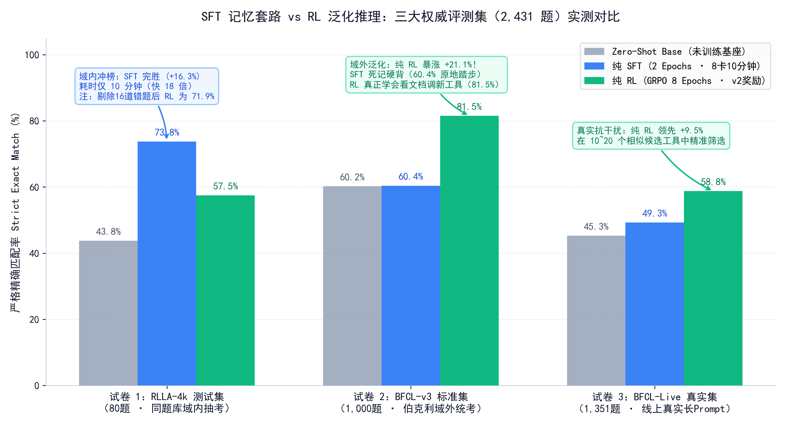
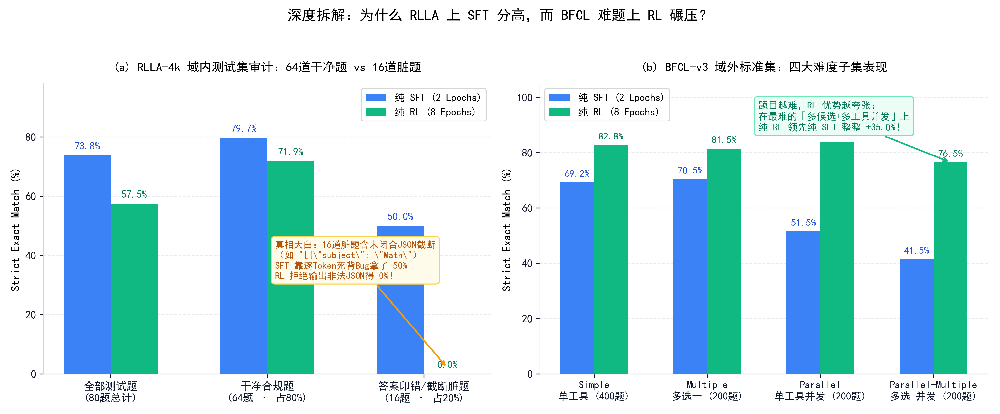
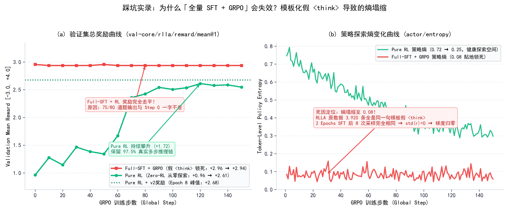
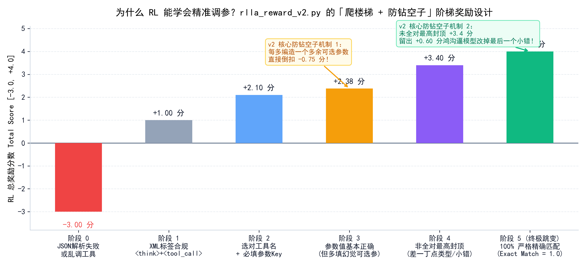

# Agent-RL-Lab: Tool-Use SFT vs. RL (VeRL GRPO + LLaMA-Factory)

基于 **VeRL (GRPO)** 与 **LLaMA-Factory (SFT)** 的大模型工具调用（Function Calling / Tool-Use Agent）全链路实验与方法研究仓库。

> **核心专题长文**：[**《冲固定垂域用 SFT，还是上 RL？从 2,431 道评测题看透 SFT 记忆与 RL 泛化的本质边界》**](docs/SFT_vs_RL_Tool_Use_Deep_Dive.md)

---

## 核心实验结论与可视化看板

在同一份开源工具调用训练集 `ToolRL / RLLA-4k`（3,920 条）上，我们以 **Qwen3-4B-Base** 为底座严格训练了 **5 组对照模型**，并在 **3 大权威评测集（共 2,431 道题）** 上进行了全面评测：

1. **试卷 1（域内抽考）：`RLLA-4k Test`（80 题）** —— 与训练集同源同分布（含 64 道干净题 + 16 道原数据集转换截断/类型污染脏题）。
2. **试卷 2（域外统考）：`BFCL-v3 Standard`（1,000 题）** —— UC Berkeley 全球权威标准集（`Simple 400` + `Multiple 200` + `Parallel 200` + `Parallel-Multiple 200`），API 在训练集中从未出现。
3. **试卷 3（真实线上）：`BFCL-v3 Live`（1,351 题）** —— 真实开发者提交的线上请求，每题挂载 10~20 个高相似候选工具干扰。



### 五组对照模型评测汇总表

| 模型方案 | 训练成本 | `RLLA-4k` 域内测试集<br>（全集 80题 / 干净题 64题） | `BFCL-v3` 域外标准集<br>（1,000题 · Strict / Norm EM） | `BFCL-Live` 真实用户集<br>（1,351题 · Strict / Norm EM） | 真 `<think>` 推理率 |
| :--- | :---: | :---: | :---: | :---: | :---: |
| **0. Zero-Shot Base** (`Qwen3-4B-Base-rlla`) | 0 分钟 | `43.75%` / `54.69%` | `60.20%` / `63.60%` | `45.30%` / `51.89%` | `93.8%` |
| **1. 纯 SFT** (`Full 3,920条 × 2 Epochs`) | **8 卡 10 分钟** | **`73.75%`** / **`79.69%`** | `60.40%` / `64.60%` | `49.30%` / `58.92%` | `0.0%` *(模板套话)* |
| **2. 全量 SFT + RL** (`2Ep SFT + 120步 GRPO`) | 10 分钟 + 1.5 小时 | `72.50%` / `78.12%` | `59.70%` / `63.90%` | `48.93%` / `58.77%` | `0.0%` *(熵塌缩 0.08)* |
| **3. 微缩冷启动 SFT** (`320条真推理 × 1 Ep`) | **8 卡 1 分钟** | `50.00%` / `60.94%` | `67.10%` / `70.50%` | `51.81%` / `59.44%` | `95.0%` |
| **4. 纯 RL** (`Zero-RL GRPO 4 Epochs`) | 32 卡 1.5 小时 | `56.25%` / `70.31%` | `79.70%` / `81.90%` | `58.11%` / `64.99%` | `97.5%` |
| **5. 纯 RL 升级版** (`v2 奖励 + 8 Epochs`) | 32 卡 3.0 小时 | `57.50%` / **`71.88%`** | **`81.50%`** / **`83.40%`** | **`58.77%`** / **`65.58%`** | **`98.8%`** |

---

## 四大关键发现与工程避坑指南

### 1. 冲固定垂域指标用 SFT，做跨场景泛化与复杂推演用 RL
- **域内冲榜（`RLLA-4k`）**：如果有同源同分布的标注数据，**纯 SFT 仅需 10 分钟即可冲到 `73.75%`**（干净题 `79.69%`），能够完美拟合目标题库的默认参数潜规则与固定拒答话术，性价比最高。
- **域外泛化（`BFCL-v3` & `BFCL-Live`）**：一旦面对训练未见过的外部 API，死记硬背的纯 SFT 在 `BFCL-v3` 上仅考 `60.40%`（比未训练基座 `60.20%` 仅高 `0.2%`）；而 **纯 RL 达到了 `81.50%`（领先 +21.1%）**，在最难的 `Parallel-Multiple`（多候选+多工具并发）子集上更是以 **`76.50%` vs `41.50%`（+35.0%）** 取得压倒性优势。



### 2. 为什么「全量 SFT + GRPO」奖励曲线完全走平？—— 模板化假 `<think>` 引发的策略熵塌缩
- `RLLA-4k` 原数据集的全部 3,920 条样本中，`<think>` 标签内均为作者批量硬塞的同一句 14 词英文套话（`"I should use the appropriate tool..."`）。
- **SFT** 通过逐 Token 强制拟合，将这句假套话背了 3,920 遍，彻底抹杀了基座模型的真实推理能力，导致策略熵（`actor/entropy`）从 `0.72` 塌缩至 `0.08`。
- 当接续 **GRPO** 时，$G=8$ 次采样生成的回答 100% 相同 $\rightarrow$ 组内标准差 $\text{std}(r)=0$ $\rightarrow$ 优势梯度归零（120 步后 75/80 道测试题输出与第 0 步一字不差）。
- 反观 **纯 RL**，由于奖励函数只校验 `<tool_call>` 内的 JSON 而忽略标准答案中的假 `<think>`，模型得以自由发挥并强化自身的真实多步思考链（如推算分页偏移 `skip = 20 - 1 = 19`、闭区间个数 `80 - 70 + 1 = 11`）。



### 3. 防钻空子细粒度奖励函数设计（`rewards/rlla_reward_v2.py`）
为了防止 GRPO 训练初期全得 0 分躺平或后期钻规则空子（Reward Hacking），我们设计了 `-3.0` 到 `+4.0` 的六级阶梯奖励：
- **严惩幻觉多余参数（`-0.75 / extra_key`）**：彻底根治模型“把所有可选参数全填一遍碰运气”的作弊行为。
- **非全对封顶与终极跳变（`+3.4` $\rightarrow$ `+4.0`）**：任何未达到 100% 精确匹配的调用最高封顶 `+3.4` 分，留出 `+0.6` 分鸿沟逼迫模型修正最后一个参数细节。



### 4. Qwen3-Base 词表外科手术与 LLaMA-Factory $\leftrightarrow$ VeRL 零错位对齐
- **解决 Base 模型乱码崩塌（`scripts/prepare_qwen3_base_tokenizer.py`）**：`Qwen3-4B-Base` 词表中 `151644..151668`（`<|im_end|>`、`<think>`、`<tool_call>` 等）从未在预训练中更新过，与 2,227 个生僻字共享同一个未初始化向量（`norm=0.3574`）。我们将其从 `added_tokens` 剥离，使其退化为已充分预训练的 BPE 子词，并以已训练的 `<|endoftext|>`（`151643`）作为唯一 EOS，使 Step 0 验证集准确率直接从 `0.00%` 恢复至 `43.75%`。
- **跨框架 Token 级 100% 对齐（`configs/sft_qwen3_4b_base_rlla.yaml`）**：在 LLaMA-Factory 中省略 `template` 参数，使其直接读取模型自带的 `tokenizer.chat_template`（`replace_eos=False`），确保 SFT 与 VeRL 的 `prompt_ids` / `response_ids` 完全一致。

---

## 仓库目录结构

```text
agent-rl-lab/
├── assets/                                  # 实验结果可视化图表 (300 DPI PNG)
├── docs/
│   └── SFT_vs_RL_Tool_Use_Deep_Dive.md      # 完整实验复盘与工业界选型指南长文
├── configs/
│   ├── sft_qwen3_4b_base_rlla.yaml          # LLaMA-Factory 全量 SFT 配置 (与 VeRL Token 级对齐)
│   └── sft_coldstart_qwen3_4b_base_rlla.yaml# DeepSeek-R1 式 320 条真推理微缩冷启动 SFT 配置
├── rewards/
│   ├── rlla_reward.py                       # 原论文 ToolRL 细粒度规则奖励函数 (v1)
│   └── rlla_reward_v2.py                    # 防钻空子升级版奖励函数 (v2：多余参数惩罚 + 精确匹配跳变)
├── scripts/
│   ├── download_rlla4k.sh                   # 下载 RLLA-4k 数据集
│   ├── prepare_qwen3_base_tokenizer.py      # Qwen3-Base 未训练特殊 Token 剥离与 EOS 修复
│   ├── prepare_sft_data.py                  # Parquet 转 LLaMA-Factory ShareGPT JSON + Reward 自检
│   ├── build_coldstart_sft_data.py          # 拒绝采样蒸馏 320 条真推理冷启动数据
│   ├── run_sft_rlla.sh                      # 启动全量 SFT 训练 (8x GPU DeepSpeed ZeRO-2)
│   ├── run_sft_coldstart_rlla.sh            # 启动微缩冷启动 SFT 训练
│   ├── run_grpo_rlla.sh                     # 启动 VeRL GRPO 强化学习训练 (v1)
│   ├── run_grpo_rlla_v2.sh                  # 启动 VeRL GRPO 升级版训练 (v2 奖励)
│   └── generate_github_figures.py           # 一键生成 assets/ 下的全套分析图表
└── eval/
    ├── compare_models.py                    # RLLA-4k 域内多维度评测脚本
    ├── run_multi_benchmark_eval.py          # RLLA-4k + BFCL-v3 (1,320题) 跨基准联合评测
    ├── run_bfcl_live_eval.py                # BFCL-v3 Live (1,351题) 真实用户集评测
    ├── summarize_multi_benchmark.py         # 汇总生成评测报告 JSON 与 Markdown
    ├── multi_benchmark_report.md            # 完整评测报告表格
    └── rlla4k_model_comparison.json         # RLLA-4k 详细评测指标存档
```

---

## 快速复现指南

### 1. 数据准备与 Base 模型词表修复

```bash
# 1. 下载 RLLA-4k 数据集
bash scripts/download_rlla4k.sh

# 2. 构建修复特殊 Token 后的 Qwen3-4B-Base-rlla 模型目录
python3 scripts/prepare_qwen3_base_tokenizer.py

# 3. 转换 SFT 格式数据并执行 100% 奖励函数自检
python3 scripts/prepare_sft_data.py
```

### 2. 路线 A：运行纯 RL / 升级版 `v2` RL（推荐通用 Agent 与复杂推理）

```bash
# 第一阶段：从 Base 启动 4 Epochs Zero-RL (v1)
bash scripts/run_grpo_rlla.sh

# 第二阶段：使用防钻空子 v2 奖励函数继续强化训练
bash scripts/run_grpo_rlla_v2.sh
```

### 3. 路线 B：运行全量 SFT 或微缩冷启动 SFT（推荐固定垂域快速冲榜）

```bash
# 方案 1：全量 2 Epochs SFT（单机 8 卡约 10 分钟，域内 RLLA 可达 73.75%）
bash scripts/run_sft_rlla.sh

# 方案 2：拒绝采样蒸馏 320 条真推理样本 + 1 Epoch 微缩冷启动 SFT（保留 95% 真推理）
python3 scripts/build_coldstart_sft_data.py
bash scripts/run_sft_coldstart_rlla.sh
```

### 4. 一键运行三大基准评测（2,431 题）

```bash
# 评测 RLLA-4k (80题) + BFCL-v3 标准集 (1,240题)
python3 eval/run_multi_benchmark_eval.py
python3 eval/summarize_multi_benchmark.py

# 评测 BFCL-v3 Live 真实用户集 (1,351题)
python3 eval/run_bfcl_live_eval.py
```
