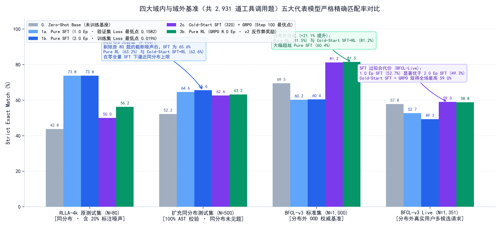
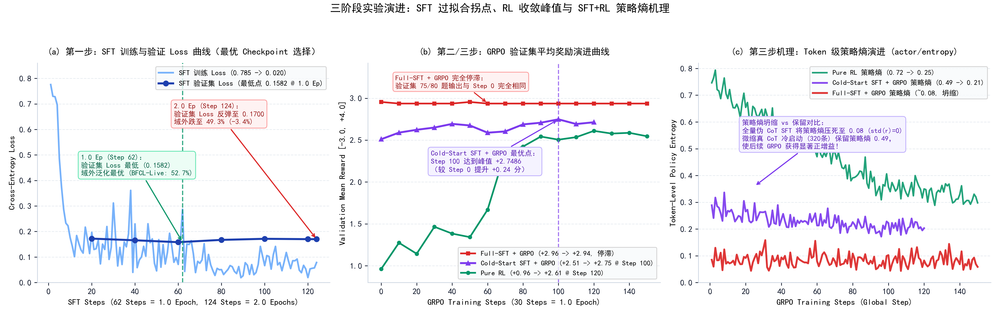
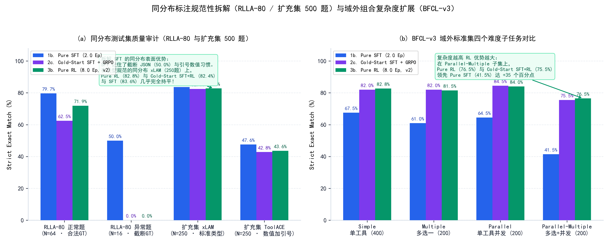
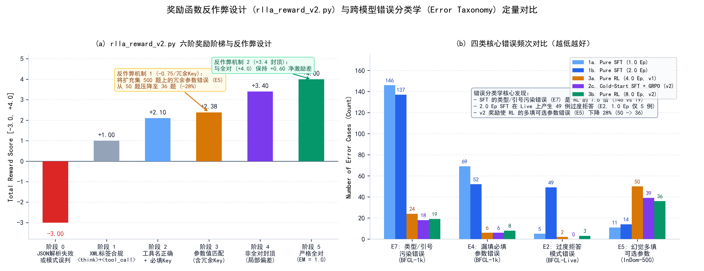

<div align="center">

# Agent-RL-Lab: 大模型工具调用中 SFT 与 RL (GRPO) 的系统性实证研究

**基于 `Qwen3-4B-Base` 的三阶段实验探索：SFT 过拟合拐点、GRPO 奖励函数反作弊设计、策略熵坍缩机理与微缩真推理冷启动 (`Cold-Start SFT + GRPO`) 正向协同**

[](README.md)
[](README_zh.md)
[-7c3aed?style=for-the-badge)](docs/SFT_vs_RL_Tool_Use_Deep_Dive.md)
[-d97706?style=for-the-badge)](docs/SFT_vs_RL_Tool_Use_Deep_Dive_zh.md)

[-10b981?style=flat-square)](https://github.com/volcengine/verl)
[-3b82f6?style=flat-square)](https://github.com/hiyouga/LLaMA-Factory)
[](https://huggingface.co/Qwen)
[](#2-四大评测基准设计与全量实验矩阵-n--3171)

</div>

---

## 研究背景与三大核心问题

将预训练基座模型（`Qwen3-4B-Base`）后训练为高可靠性的 **工具调用智能体（Tool-Calling Agent）** 时，算法工程师通常面临三个核心问题：
1. **第一阶段 —— 监督微调探索（`Pure SFT`）**：如何基于训练集与验证集 Loss 曲线科学选择 SFT 最优 Checkpoint（`1.0 Epoch` vs. `2.0 Epochs`）？为什么在同分布工具集（`RLLA-4k`）上做标准全量 SFT 会导致分布外（OOD）泛化能力显著退化？
2. **第二阶段 —— 纯强化学习探索（`Zero-RL GRPO`）**：不依赖 SFT、直接从基座模型启动 `GRPO` 强化学习能否收敛？如何通过精细化奖励工程（`v1` $\rightarrow$ `v2` 反作弊设计）消除多填可选参数等 Reward Hacking 行为，并依据验证集奖励曲线选择最佳收敛点？
3. **第三阶段 —— `SFT + GRPO` 组合范式探索**：为什么在全量 SFT 模型之后直接拼接 GRPO 会陷入完全停滞（**策略熵坍缩 Policy Entropy Collapse**）？如何通过 **微缩真推理冷启动（`Cold-Start SFT 320条`）+ `GRPO`** 保护策略探索空间，实现 `SFT + RL > 单一 SFT` 的显著正增益？

围绕上述递进式研究主线，本仓库对 **8 个严格受控的模型 Checkpoint** 在 **4 大评测基准（共 `3,171` 道测试样本，含新建的 `500` 题 AST 校验同分布扩充测试集）** 上进行了系统性评测，并构建了覆盖 7 类精细错误模式的 **错误分类学（Error Taxonomy `E1`–`E7`）**。

<div align="center">
  
</div>

---

## 1. 三阶段递进式实验主线与最优 Checkpoint 选择准则

在对比 SFT 与 RL 时，如果随意选取某个训练步数，极易因过拟合或欠收敛得出片面结论。图 2 展示了本项目三阶段实验的完整 Loss/Reward 收敛轨迹及最优 Checkpoint 选择依据：

<div align="center">
  
</div>

### 第一阶段：SFT 探索与过拟合拐点分析（`Model 1a: 1.0 Ep` vs. `Model 1b: 2.0 Ep`）
我们在 `RLLA-4k` 全量训练集（`3,920` 条样本，全局 Batch Size `64`，每 Epoch `62` 步）上使用 LLaMA-Factory 进行全参 SFT，并在每个 Epoch 结束时评测验证集交叉熵损失（`eval_loss`）：

| SFT 模型版本 | 训练步数 | 训练集 Loss (`train_loss`) | 验证集 Loss (`eval_loss`) | RLLA-80 严格 EM | 扩充同分布 500 题 EM | BFCL-v3 (1,000题) 严格/归一化 EM | BFCL-Live (1,351题) 严格/归一化 EM |
| :--- | :---: | :---: | :---: | :---: | :---: | :---: | :---: |
| **`Model 1a`: Pure SFT (`1.0 Ep`, 验证集 Loss 最低点)** | `Step 62` | `0.1510` | **`0.1582` (全局最低)** | `73.75%` | `64.60%` | `60.20%` / **`74.80%`** | **`52.70%` / `66.17%`** |
| **`Model 1b`: Pure SFT (`2.0 Ep`, 训练集 Loss 最低点)** | `Step 124` | **`0.0196`** | `0.1700` (`+7.5%` 反弹) | `73.75%` | **`65.60%`** | `60.40%` / `74.10%` | `49.30%` / `62.92%` (`-3.40%`) |

- **验证集 `eval_loss` 与训练集 `train_loss` 的背离拐点**：从 `1.0 Epoch (Step 62)` 到 `2.0 Epochs (Step 124)`，训练集 `train_loss` 下降了 `87%`（`0.1510` $\rightarrow$ `0.0196`），但验证集 `eval_loss` 从全局最低点 **`0.1582` 反弹至 `0.1700`（恶化 `+7.5%`）**。
- **同分布死记硬背 vs. 分布外泛化退化**：多训第 2 个 Epoch 在完全共享训练集工具 Schema 的 `扩充同分布测试集 (N=500)` 上带来微弱提升（`64.60%` $\rightarrow$ `65.60%`），但在分布外真实企业级测试集 `BFCL-Live (N=1,351)` 上，严格精确匹配率从 **`52.70%` 暴跌至 `49.30%`（下降 `-3.40` 个百分点）**！错误分类学（第 4 节）揭示：第 2 个 Epoch 导致模型在面对复杂 OOD 工具表时产生严重的 **过度拒答错误（`E2_False_Abstention` 从 `5` 例激增 `9.8 倍` 至 `49` 例）**。
- **真实推理链彻底丧失（`Genuine CoT = 0.0%`）**：由于 `RLLA-4k` 训练集 `99.4%`（`3,895 / 3,920`）的样本在 `<think>` 标签内均为同一句 16 词空洞模板（`"I should use the appropriate tool with proper parameters to respond to the user's need."`），全序列 Token 级交叉熵监督迫使 `1.0 Ep` 和 `2.0 Ep` 模型 100% 复读该模板句，彻底抹除了基座模型原有的先验算术与逻辑校验能力。

---

### 第二阶段：纯强化学习（`Zero-RL GRPO`）探索、反作弊奖励迭代（`v1` $\rightarrow$ `v2`）与收敛峰值选择（`Model 3a` vs. `Model 3b`）
跳过 SFT，我们直接从 `Qwen3-4B-Base-rlla` 启动 **VeRL GRPO**（每题采样 $G=8$ 条轨迹，`KL = 0.001`），每 10 步（`30 步 = 1.0 Epoch`）在验证集上监控 `val_reward` 曲线以选取收敛最优点：

| RL 训练阶段与奖励版本 | 训练区间 | 验证集平均奖励演进轨迹 (`Step 0` $\rightarrow$ 峰值 $\rightarrow$ 末步) | 选定最优 Checkpoint | 扩充同分布 500 题 EM | BFCL-v3 (1,000题) 严格/归一化 EM | BFCL-Live (1,351题) 严格/归一化 EM |
| :--- | :---: | :---: | :---: | :---: | :---: | :---: |
| **`Model 3a`: Pure RL (`v1` 基础过程奖励)** | `0 -> 4.0 Ep` (`120` 步) | `+0.4090` $\rightarrow$ **`+2.6584` (`Step 120`)** | `Step 120` (`4.0 Ep`) | `59.00%` | `79.70%` / `82.10%` | `58.33%` / `64.91%` |
| **`Model 3b`: Pure RL (`v2` 反作弊奖励)** | `4.0 -> 9.0 Ep` (`150` 步) | `+2.6594` $\rightarrow$ **`+2.7421` (`Step 120`)** $\rightarrow$ `+2.7077` (`Step 150`) | **`Step 120` (`8.0 Ep`)** | **`63.20%` (`+4.20%`)** | **`81.50%` / `83.40%`** | **`58.77%` / `65.58%`** |

- **为什么同一份数据集下 Pure RL 能 100% 保留真实 `<think>` 推理链**：结果导向奖励函数（`rewards/rlla_reward_v2.py`）仅对 `<think>...</think>` 做标签闭合检查（`+1.0` 格式分），而核心准确度分（`[-3.0, +3.0]`）**仅对 `<tool_call>` 内的 JSON 抽象语法树（AST）进行比对，完全忽略 Ground Truth 中那句伪 `<think>` 模板文本**。在 $G=8$ 组内采样中，包含真实参数提取与算术推导的轨迹能拿到满分 `+4.0`（正优势 $A_i > 0$），从而自发强化出平均 ~280 字符的真实推理链。
- **定位并根治 `v1` 奖励的 Reward Hacking（`v1` $\rightarrow$ `v2`）**：对 `Model 3a (v1 奖励)` 进行错误分类学审计发现，模型在 `扩充同分布 500 题` 上出现了 `50` 例 **`E5_Hallucinated_Extra_Param_Key`（盲目多填可选参数）** —— 因为 `v1` 每多填一个冗余参数仅扣 `-0.25` 分，且非全对最高可拿 `+3.75` 分（与全对 `+4.0` 仅差 `0.25` 分）。在 `rewards/rlla_reward_v2.py` 中，我们将冗余参数惩罚加重 3 倍至 **`-0.75/key`**，并将非全对准确度封顶在 **`+2.40`（总分封顶 `+3.40` vs. 全对 `+4.00`）**。训练至 `Step 120` 验证集峰值（`+2.7421`，`Step 150` 回落至 `+2.7077`）后，**`E5` 多填可选参数错误下降 `28%`（`50` $\rightarrow$ `36` 例）**，扩充同分布 500 题严格 EM 跃升 **`+4.20%`（`59.00%` $\rightarrow$ `63.20%`）**，分布外 `BFCL-v3` 达到全场最高 **`81.50%`**！

---

### 第三阶段：`SFT + GRPO` 组合探索 —— 破解策略熵坍缩悖论（负向对照 `Model 2a` vs. 正向对照 `Model 2c`）
为什么常规的 `全量 SFT -> GRPO` 在工具调用任务上完全无效？怎样设计 SFT 才能让后续 GRPO 真正发挥强化学习优势？我们在完全相同的 32 卡 VeRL GRPO 环境下进行了严格对照实验：

| `SFT + RL` 组合方案 | 初始策略熵 (`Step 0`) | GRPO 验证集奖励轨迹 (`Step 0` $\rightarrow$ 峰值) | 真实推理链保留率 | 扩充同分布 500 题 EM | BFCL-v3 (1,000题) 严格/归一化 EM | BFCL-Live (1,351题) 严格/归一化 EM |
| :--- | :---: | :---: | :---: | :---: | :---: | :---: |
| **`Model 2a`: Full-SFT (`2Ep`) + GRPO (负向对照)** | `0.085` (严重坍缩) | `+2.9558` $\rightarrow$ `+2.9370` (完全停滞) | `0.0%` | `65.20%` (较 SFT `-0.40%`) | `59.50%` / `73.60%` (`-0.90%`) | `49.30%` / `63.06%` (`+0.00%`) |
| **`Model 2b`: Cold-Start SFT (`320条真CoT`, `1Ep`)** | `0.492` (高熵健康) | `+2.5112` (`Step 0` 起点) | `99.8%` | `60.00%` | `79.30%` / `81.60%` | `58.92%` / `64.99%` |
| **`Model 2c`: Cold-Start SFT (`320`) + GRPO (`Step 100`, 正向对照)** | `0.492` $\rightarrow$ `0.215` | `+2.5112` $\rightarrow$ **`+2.7486` (`Step 100` 峰值)** | **`100.0%`** | **`62.60%` (`+2.60%` 正增益)** | **`81.20%` / `83.00%` (`+1.90%` 正增益)** | **`58.99%` / `65.21%` (全场最高)** |

1. **为什么 `Full-SFT (2Ep) + GRPO` 彻底失效（`Model 2a` 负向对照）**：
   - 全量伪 CoT SFT 训练 2 个 Epoch 后，模型输出分布高度尖锐化，Token 级策略熵（`actor/entropy`）坍缩至 **`0.08–0.12`**。
   - 在 GRPO 阶段（即使采样温度 `T = 1.0`），同一 Prompt 采样出的 $G=8$ 条轨迹在 `<think>` 上 100% 输出同一句模板，导致 `<tool_call>` JSON 也几乎完全一致，组内奖励标准差 $\sigma_r = 0 \implies$ 优势函数 $A_i = 0$。120 步 GRPO 结束后，验证集 `75 / 80` 道题的输出与 Step 0 **逐字符完全相同**。
2. **`Cold-Start SFT (320条) + GRPO` 如何实现正向协同（`Model 2c` 正向对照）**：
   - 我们通过拒绝采样筛选出 **`320` 条包含完整 `<think>` 真实推理链的高质量样本**（`data/sft_coldstart_320/train_coldstart_320.json`），仅以低学习率（`1e-5`）微调 **`1.0 Epoch`（仅 `5` 步梯度更新）** 得到 `Model 2b`。
   - 这一轻量级冷启动将初始 XML 格式合规率从基座的 `2.5%` 直接拉升至 **`93.75%`**（`Step 0` 验证集奖励达 **`+2.5112`**，远高于零样本基座的 `+0.4090`），同时将初始策略熵完好保留在 **`0.492`**！
   - 随后接入 `GRPO (v2 奖励)` 训练 120 步（`grpo-rlla4k-v2reward-ColdStartSFT320-n4g8`），验证集奖励从 **`+2.5112` (`Step 0`) 稳步攀升至 `+2.6504` (`Step 30`) $\rightarrow$ `+2.7079` (`Step 90`) $\rightarrow$ `+2.7486` (`Step 100` 全局峰值)**（`Step 120` 小幅回落至 `+2.7136`）。
   - 评测 `Step 100` 最优 Checkpoint（`Model 2c`）证实了显著的 **`SFT + RL` 正向增益**：
     - **`扩充同分布 500 题`**：严格 EM 从 `60.00%` 提升至 **`62.60%`（`+2.60%`）**，其中高难度 **多工具并发子集（`Multi-Tool 250`）从 `48.40%` 跃升至 `54.80%`（`+6.40%`）**；
     - **`BFCL-v3 标准集 (1,000题)`**：严格 EM 从 `79.30%` 提升至 **`81.20%`（归一化 EM `83.00%`）**，其中最难的 **`Parallel-Multiple (200题)` 从 `70.00%` 跃升至 `75.50%`（`+5.50%`）**；
     - **`BFCL-v3 Live (1,351题)`**：取得全部 8 个模型中的 **最高严格精确匹配率（`58.99%`，797/1,351 题全对，100.0% 真实 CoT）**！

---

## 2. 四大评测基准设计与全量实验矩阵 (`N = 3,171`)

针对原 `RLLA-4k` 测试集仅 `80` 题、样本量偏小且存在标注噪声的问题，我们从 `ToolACE` 与 `xLAM-60k` 原始语料中严格按 **`100% 候选工具出现在 train.parquet 中（严格同分布）` + `0% 题目与训练/测试集重合` + `100% 通过 JSON AST 语法校验`** 的标准，构建了 **`500` 题扩充同分布测试集（`data/rlla_4k/test_indomain_500.parquet`）**，形成覆盖 **`3,171` 道样本** 的四大评测体系：

| 评测基准 (Benchmark Suite) | 样本量 | 领域分布属性 | 子集构成与核心考察维度 |
| :--- | :---: | :---: | :--- |
| **1. `RLLA-4k` 原始测试集** | `80` | **同分布 In-Domain** (原切分) | `36` 单工具 + `35` 多工具 + `9` 缺参拒答（含 `64` 道合法 GT + `16` 道截断/类型污染异常 GT）。 |
| **2. `RLLA-4k` 扩充同分布测试集** (`test_indomain_500.parquet`) | **`500`** (`6.25倍` 扩充) | **严格同分布 In-Domain** (工具 100% 见过，题目全新) | `250` 单工具 + `250` 多工具并发（`250` 道 xLAM 标准类型 + `250` 道 ToolACE 字符串引号风格），**100% 通过 AST 校验**。 |
| **3. `BFCL-v3` 标准评测集** | `1,240` (`1,000` 调用 + `240` 拒答) | **分布外 OOD** (全新工具 Schema) | `400` Simple + `200` Multiple + `200` Parallel + `200` Parallel-Multiple + `240` Irrelevance 无关工具拒答。 |
| **4. `BFCL-v3 Live` 真实世界评测集** | `1,351` | **分布外 OOD** (真实生产环境长上下文) | `258` Live-Simple + `1,053` Live-Multiple + `16` Live-Parallel + `24` Live-Parallel-Multiple（单题含 `10~20` 个候选工具）。 |

### 八大模型 × 四大评测集主实验结果总表（`严格 EM%` / `Schema 归一化 EM%`）

| 模型编号与训练范式 | RLLA-4k 原测试集 (`N=80`) | 扩充同分布测试集 (`N=500`) | BFCL-v3 标准集 (`N=1,000`) | BFCL-v3 Live (`N=1,351`) | BFCL 无关拒答 (`N=240`) | 真实 `<think>` 推理链占比 |
| :--- | :---: | :---: | :---: | :---: | :---: | :---: |
| **`0. Zero-Shot Base`** (`Qwen3-4B-Base-rlla`) | `43.75%` / `50.00%` | `52.20%` / `53.00%` | `69.50%` / `72.60%` | `57.81%` / `63.73%` | `19.17%` | `99.7%` (均长 `290` 字符) |
| **`1a. Pure SFT (1.0 Ep, 验证集 Loss 最低点 0.1582)`** | **`73.75%` / `75.00%`** | `64.60%` / `69.00%` | `60.20%` / `74.80%` | `52.70%` / `66.17%` | `76.25%` | `0.0%` (`87` 字符伪模板) |
| **`1b. Pure SFT (2.0 Ep, 训练集 Loss 最低点 0.0196)`** | **`73.75%` / `75.00%`** | **`65.60%` / `69.80%`** | `60.40%` / `74.10%` | `49.30%` / `62.92%` | **`89.17%`** | `0.0%` (`87` 字符伪模板) |
| **`2a. Full-SFT (2.0 Ep) + GRPO (Step 120, 负向对照)`** | `72.50%` / `75.00%` | `65.20%` / `69.60%` | `59.50%` / `73.60%` | `49.30%` / `63.06%` | `88.33%` | `0.0%` (`87` 字符伪模板) |
| **`2b. Cold-Start SFT (320条真CoT, 1.0 Ep)`** | `48.75%` / `55.00%` | `60.00%` / `60.40%` | `79.30%` / `81.60%` | `58.92%` / `64.99%` | `16.25%` | `99.8%` (均长 `249` 字符) |
| **`2c. Cold-Start SFT (320) + GRPO (Step 100, 正向对照)`** | `50.00%` / `57.50%` | `62.60%` / `63.00%` | `81.20%` / `83.00%` | **`58.99%`** / `65.21%` | `15.83%` | **`100.0%`** (均长 `268` 字符) |
| **`3a. Pure RL (Zero-RL GRPO, 4.0 Ep, v1 奖励)`** | `53.75%` / `60.00%` | `59.00%` / `59.60%` | `79.70%` / `82.10%` | `58.33%` / `64.91%` | **`22.50%`** | **`100.0%`** (均长 `275` 字符) |
| **`3b. Pure RL (Zero-RL GRPO, 8.0 Ep, v2 奖励)`** | `56.25%` / `61.25%` | `63.20%` / `63.20%` | **`81.50%` / `83.40%`** | `58.77%` / **`65.58%`** | `20.83%` | **`100.0%`** (均长 `281` 字符) |

---

## 3. 同分布标注规范性拆解与域外组合复杂度扩展分析

为什么在 `RLLA-4k (80题)` 上 `Pure SFT` 表面领先 `Pure RL` 达 `+17.5%`（`73.75%` vs. `56.25%`），但在 `扩充同分布测试集 (500题)` 上差距缩小至 **`2.4%`**（`65.60%` vs. `63.20%`），而在 `BFCL-v3 (1,000题)` 上 `Pure RL` 反超 SFT **`+21.1%`**（`81.50%` vs. `60.40%`）？图 3 揭示了背后的深层机理：

<div align="center">
  
</div>

### 3.1 同分布测试集细粒度拆解（`RLLA-80` 与 `扩充同分布 500 题`）

| 同分布子集分类 | 样本量 | `0. Base` | `1a. SFT (1Ep)` | `1b. SFT (2Ep)` | `2b. Cold-Start SFT` | `2c. Cold-Start SFT + GRPO` | `3a. Pure RL (v1)` | `3b. Pure RL (v2)` |
| :--- | :---: | :---: | :---: | :---: | :---: | :---: | :---: | :---: |
| **`RLLA-80` 正常合法 GT 子集** | `64` | `54.69%` | `79.69%` | **`79.69%`** | `60.94%` | `62.50%` | `67.19%` | **`71.88%`** |
| **`RLLA-80` 截断/引号污染异常 GT** | `16` | `0.00%` | `50.00%` | **`50.00%`** | `0.00%` | `0.00%` | `0.00%` | **`0.00%`** |
| **`扩充集 500` 单工具调用 (`Single-Tool`)** | `250` | `55.60%` | `69.60%` | `71.60%` | **`71.60%`** | `70.40%` | `68.40%` | `70.80%` |
| **`扩充集 500` 多工具并发 (`Multi-Tool >=2`)** | `250` | `48.80%` | **`59.60%`** | **`59.60%`** | `48.40%` | `54.80%` (`+6.4%` vs 2b) | `49.60%` | **`55.60%`** (`+6.0%` vs 3a) |
| **`扩充集 500` xLAM 源 (`标准 JSON 类型`)** | `250` | `69.60%` | `82.80%` | **`83.60%`** | `80.80%` | **`82.40%`** | `79.20%` | **`82.80%`** |
| **`扩充集 500` ToolACE 源 (`含引号数值习惯`)** | `250` | `34.80%` | `46.40%` | **`47.60%`** | `39.20%` | `42.80%` | `38.80%` | **`43.60%`** |

1. **原 `RLLA-80` 中的 20% 标注异常噪声（`16 / 80` 题）**：原测试集中有 `16` 道题的 Ground Truth 存在未闭合 JSON 字符串截断（如 `"[{"subject": "Math"`）或违背 Schema `type: integer` 的字符串引号包装。`Pure SFT` 靠死记硬背训练集中的同类脏数据缺陷拿到了 `50.0%`（`8/16`），而坚持输出合法 JSON 的 `Pure RL` 与 `Cold-Start SFT + GRPO` 在这 16 道错题上得分为 `0.0%`。
2. **在类型规范的同分布 `xLAM-250` 上 RL 与 SFT 几乎完全持平**：在 AST 严格合法、参数类型规范的 `扩充集 xLAM (250题)` 上，**`Pure RL (v2)`（`82.80%`）与 `Cold-Start SFT + GRPO`（`82.40%`）在未做全量 SFT 的情况下，与 `Pure SFT`（`83.60%`）仅差 `0.8%`！**
3. **即便在同分布测试集上，需要隐式算术推导的题目依然是 RL 完胜 SFT**：例如计算零基分页偏移量 `skip = 20 - 1 = 19`（`rlla_test_20`）或闭区间年份计数 `80 - 70 + 1 = 11`（`rlla_test_55`），`Pure RL` 与 `Cold-Start SFT + GRPO` 依靠 `<think>` 算术推理拿到满分 `1.0`，而 `Pure SFT` 机械照抄题干字面数字填出 `20` 和 `10`（得分 `0.0`）。

---

## 4. 跨模型错误分类学 (`E1`–`E7`) 与典型失败案例深度剖析

为了超越单一准确率数字、定量揭示不同训练范式的失败机理，`eval/analyze_error_taxonomy.py` 将所有非全对预测精确归类为 **7 种互斥的错误类型**：
- **`E1` 格式或 JSON 语法错误**：缺失 `<tool_call>` 标签或输出的 JSON 字符串无法被 `json.loads` 解析。
- **`E2` 模式误判 / 过度拒答错误**：有合适工具时错误输出 `<response>` 拒答（False Abstention），或无工具可用时强行胡乱调用工具。
- **`E3a` 工具名选错**：调用数量正确，但从候选工具列表中选错了工具名称。
- **`E3b` 多工具调用数量错误**：并发调用次数不匹配（例如应并发调用 2 次工具，模型仅调用 1 次或拆错数量）。
- **`E4` 漏填必填参数 Key**：遗漏了 Schema `required` 或 Ground Truth 中明确要求的核心参数字段。
- **`E5` 幻觉多填冗余参数 Key**：画蛇添足地填入了用户未提及的可选参数（Optional Keys）或捏造了不存在的参数名。
- **`E6` 参数值提取或算术计算错误**：工具名与参数 Key 完全正确，但参数值计算错误（如 off-by-one 算术错误）或字符串提取偏差。
- **`E7` 纯数据类型/引号风格偏差**：语义与数值完全正确（`Schema-Normalized EM = 1.0`），仅因将整数/布尔值加了字符串引号（如 `"10"` vs `10`）导致严格匹配失败。

<div align="center">
  
</div>

### 三大主力基准上的错误分类学统计表 (`eval/error_taxonomy_report.json`)

#### A. 分布外标准集 `BFCL-v3 Standard` (`N = 1,000` 道工具调用题)

| 模型版本 | `CORRECT` (严格全对) | `E1` 格式/JSON | `E2` 过度拒答 | `E3a` 工具选错 | `E3b` 并发次数错 | `E4` 漏填必填项 | `E5` 多填冗余项 | `E6` 参数值/算术错 | `E7` 纯类型/引号污染 |
| :--- | :---: | :---: | :---: | :---: | :---: | :---: | :---: | :---: | :---: |
| **`0. Zero-Shot Base`** | `695` (`69.5%`) | `8` | `2` | `8` | `150` | `4` | `0` | `102` | `31` |
| **`1a. Pure SFT (1.0 Ep)`** | `602` (`60.2%`) | `6` | `0` | `2` | `32` | `69` | `2` | `141` | **`146`** |
| **`1b. Pure SFT (2.0 Ep)`** | `604` (`60.4%`) | `14` | `2` | `3` | `28` | `52` | `2` | `158` | **`137`** |
| **`2a. Full-SFT + GRPO`** | `595` (`59.5%`) | `14` | `2` | `3` | `25` | `55` | `2` | `164` | **`140`** |
| **`2b. Cold-Start SFT (320)`** | `793` (`79.3%`) | `7` | `1` | `7` | `45` | `6` | `0` | `118` | `23` |
| **`2c. Cold-Start SFT + GRPO`** | **`812` (`81.2%`)** | **`4`** | **`0`** | **`6`** | `27` (较2b `-40%`) | **`6`** | `1` | `126` | **`18`** |
| **`3a. Pure RL (4.0 Ep, v1)`** | `797` (`79.7%`) | `5` | `2` | `8` | `28` | `6` | `0` | `130` | `24` |
| **`3b. Pure RL (8.0 Ep, v2)`** | **`815` (`81.5%`)** | `5` | `2` | `7` | **`18`** (较3a `-36%`) | `8` | `1` | **`125`** | `19` |

#### B. 分布外真实世界 `BFCL-v3 Live` (`N = 1,351` 道多候选工具题)

| 模型版本 | `CORRECT` (严格全对) | `E1` 格式/JSON | `E2` 过度拒答 | `E3a` 工具选错 | `E3b` 并发次数错 | `E4` 漏填必填项 | `E5` 多填冗余项 | `E6` 参数值/算术错 | `E7` 纯类型/引号污染 |
| :--- | :---: | :---: | :---: | :---: | :---: | :---: | :---: | :---: | :---: |
| **`0. Zero-Shot Base`** | `781` (`57.8%`) | `3` | `3` | `57` | `21` | `32` | `17` | `357` | `80` |
| **`1a. Pure SFT (1.0 Ep)`** | `712` (`52.7%`) | `14` | `5` | `27` | `22` | `86` | `10` | `293` | **`182`** |
| **`1b. Pure SFT (2.0 Ep)`** | `666` (`49.3%`) | `11` | **`49` (激增 `9.8倍`)** | `25` | `21` | `66` | `11` | `318` | **`184`** |
| **`2c. Cold-Start SFT + GRPO`** | **`797` (`59.0%`)** | **`1`** | **`0`** | **`47`** | `27` | `48` | **`13`** | `334` | `84` |
| **`3b. Pure RL (8.0 Ep, v2)`** | `794` (`58.8%`) | **`1`** | `3` | `50` | `29` | `49` | `15` | **`318`** | `92` |

#### C. 严格同分布 `扩充同分布测试集` (`N = 500` 道未见题)

| 模型版本 | `CORRECT` (严格全对) | `E1` 格式/JSON | `E2` 模式误判 | `E3a` 工具选错 | `E3b` 并发次数错 | `E4` 漏填必填项 | `E5` 多填冗余项 | `E6` 参数值/算术错 | `E7` 纯类型/引号污染 |
| :--- | :---: | :---: | :---: | :---: | :---: | :---: | :---: | :---: | :---: |
| **`0. Zero-Shot Base`** | `261` (`52.2%`) | **`235` (缺XML标签)** | `0` | `0` | `0` | `0` | `0` | `0` | `4` |
| **`1b. Pure SFT (2.0 Ep)`** | **`328` (`65.6%`)** | `3` | `5` | `1` | `15` | `35` | `14` | **`78`** | `21` |
| **`2b. Cold-Start SFT (320)`** | `300` (`60.0%`) | `15` | `1` | `3` | `29` | `7` | `49` | `93` | `2` |
| **`2c. Cold-Start SFT + GRPO`** | `313` (`62.6%`) | `15` | `1` | `3` | `21` (`-28%`) | `9` | `39` (`-20%`) | `97` | `2` |
| **`3a. Pure RL (4.0 Ep, v1)`** | `295` (`59.0%`) | `16` | `1` | `6` | `21` | `8` | `50` | `100` | `3` |
| **`3b. Pure RL (8.0 Ep, v2)`** | `316` (`63.2%`) | `16` | `0` | `4` | `19` | `11` | **`36` (`-28%`)** | `98` | **`0`** |

### 错误分类学揭示的三大核心结论
1. **SFT 在分布外崩溃的三大罪魁祸首（`E7` 类型污染 + `E4` 漏填必填项 + `E2` 过度拒答）**：
   - 在 `BFCL-v3 (1k)` 上，`Pure SFT` 的 **`E7` 类型/引号污染错误高达 `137–146` 例**（是 `Pure RL` `18–19` 例的 **`7.6 倍`**），且 **`E4` 漏填必填参数错误高达 `52–69` 例**（是 `Pure RL` `6–8` 例的 **`8 倍`**）。因为没有 `<think>` 逐字段核对 Schema，`Pure SFT` 经常漏填必填参数并把整数/布尔值加上双引号。
   - 在 `BFCL-Live (1,351)` 上，SFT 从 `1.0 Ep` 训练到 `2.0 Ep` 导致 **`E2` 过度拒答错误从 `5` 例激增至 `49` 例（暴涨 `9.8 倍`）** —— 当面对未见过的长列表企业级工具时，过拟合的 2-Epoch SFT 误以为“没有匹配工具”而直接拒绝调用！
2. **`v2` 反作弊奖励函数对 `Pure RL` 的精准纠偏（消除 `E5` 与 `E3b`）**：
   - 从 `v1` 升级到 `v2` 后，在 `扩充同分布 500 题` 上 **`E5` 幻觉多填可选参数错误从 `50` 例降至 `36` 例（`-28%`）**，在 `BFCL-v3` 上 **`E3b` 多工具并发次数错误从 `28` 例降至 `18` 例（`-36%`）**。
3. **`Cold-Start SFT + GRPO` 相比单纯 `Cold-Start SFT` 的实质性提升机理（`2b` $\rightarrow$ `2c`）**：
   - 在保留策略熵（`0.492`）的前提下接入 GRPO，将 `BFCL-v3` 上的 **`E3b` 多工具并发次数错误削减了 `40%`（`45` $\rightarrow$ `27` 例）**，并将 `扩充同分布 500 题` 上的 **`E5` 冗余参数错误削减了 `20%`（`49` $\rightarrow$ `39` 例）**，有力证明了 `微缩真 CoT 冷启动 + GRPO` 范式的有效性。

---

## 5. 仓库目录结构与一键复现指南

```text
agent-rl-lab/
├── README.md                                  # 英文主文档 (English README)
├── README_zh.md                               # 中文主文档 (简体中文 README)
├── assets/                                    # 300-DPI 中英双语实验图表 (fig1..4.png & fig1..4_zh.png)
├── configs/
│   ├── sft_rlla_qwen3_4b_ep2.yaml             # 第一阶段：全量 SFT 配置 (3,920条, 每 Epoch 评测 eval_loss)
│   └── sft_coldstart_320_qwen3_4b_ep1.yaml    # 第三阶段：微缩真推理冷启动 SFT 配置 (320条, 1 Epoch)
├── data/
│   ├── rlla_4k/                               # RLLA-4k 训练集 (3,920)、原测试集 (80) 与扩充同分布测试集 (500)
│   └── sft_coldstart_320/                     # 拒绝采样筛选的 320 条含真实 <think> 推理链的冷启动数据
├── docs/
│   ├── SFT_vs_RL_Tool_Use_Deep_Dive.md        # 英文深度技术报告
│   └── SFT_vs_RL_Tool_Use_Deep_Dive_zh.md     # 中文深度技术报告
├── eval/
│   ├── run_multi_benchmark_eval.py            # RLLA-4k (80) + BFCL-v3 标准集 (1,240) 批量评测脚本
│   ├── run_expanded_indomain_eval.py          # 扩充同分布测试集 (500) 批量评测脚本
│   ├── run_bfcl_live_eval.py                  # BFCL-v3 Live (1,351) 批量评测脚本
│   ├── summarize_multi_benchmark.py           # 八大模型 × 四大基准全量指标汇总脚本
│   ├── analyze_error_taxonomy.py              # 七类错误分类学 (E1-E7) 定量统计脚本
│   ├── multi_benchmark_report.json            # 全量结构化评测报告 JSON
│   └── error_taxonomy_report.json             # 全量错误分类学统计 JSON
├── rewards/
│   ├── rlla_reward.py                         # 第二阶段：基础多维度工具调用奖励函数 (v1)
│   └── rlla_reward_v2.py                      # 第二/三阶段：抑制 Reward Hacking 的改进版奖励函数 (v2)
└── scripts/
    ├── prepare_model_and_data.py              # 词表未训练特殊 Token 清洗与数据预处理
    ├── build_expanded_indomain_test.py        # 构建 500 题 AST 校验严格同分布扩充测试集
    ├── run_sft_rlla.sh                        # 启动 LLaMA-Factory SFT 训练
    ├── run_grpo_rlla.sh                       # 启动多机 32 卡 VeRL GRPO 训练 (v1 奖励)
    ├── run_grpo_rlla_v2_8ep.sh                # 启动多机 32 卡 VeRL GRPO 训练 (v2 奖励，支持 Pure RL 与 Cold-Start SFT+RL)
    └── generate_github_figures.py             # 基于训练日志与评测结果一键生成中英双语图表
```

### 快速复现命令

```bash
# 1. 准备干净基座模型与全套数据集（含 500 题扩充同分布测试集）
python scripts/prepare_model_and_data.py
python scripts/build_expanded_indomain_test.py

# 2. 第一阶段：运行全量 SFT（checkpoint-62 对应 1.0 Ep 最低 eval_loss，checkpoint-124 对应 2.0 Ep）
bash scripts/run_sft_rlla.sh

# 3. 第二阶段：运行 Pure RL（Zero-RL GRPO，v1 -> v2 反作弊奖励）
bash scripts/run_grpo_rlla.sh
bash scripts/run_grpo_rlla_v2_8ep.sh

# 4. 第三阶段：运行 Cold-Start SFT (320条真CoT, 1 Ep) + GRPO (v2 奖励)
llamafactory-cli train configs/sft_coldstart_320_qwen3_4b_ep1.yaml
INIT_MODEL=outputs/sft/sft-coldstart320-Qwen3-4B-Base-rlla-ep1 bash scripts/run_grpo_rlla_v2_8ep.sh

# 5. 在四大评测集（共 3,171 题）上评测全部 8 个模型并生成错误分类学报告与双语图表
python eval/summarize_multi_benchmark.py
python eval/analyze_error_taxonomy.py
python scripts/generate_github_figures.py
```

---

## 开源协议 (License)

本项目遵循 [Apache-2.0 开源协议](LICENSE)。
