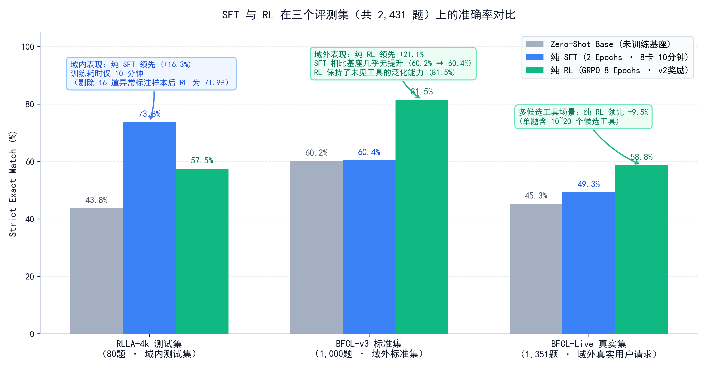
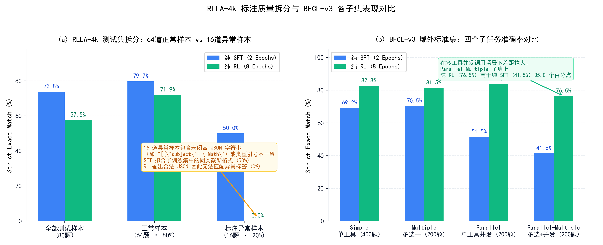
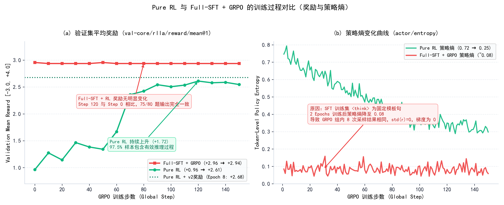
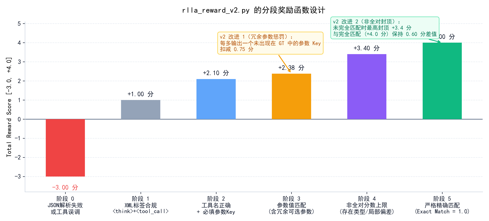

# 工具调用场景下 SFT 与 RL 的效果边界分析：基于 RLLA-4k 与 BFCL-v3 的对照实验报告

## 摘要

在构建工具调用（Function Calling / Tool-Use）模型时，工程上常面临几个具体问题：
1. 如果目标是提升某一固定测试集（或固定垂域业务接口）的准确率，直接做 SFT 是否比 RL 更高效？
2. 为什么在全量 SFT 模型基础上继续进行 GRPO 强化学习，奖励曲线往往停滞不前？
3. 在纯垂域场景、无 `<think>`（直接输出 `<tool_call>`）或线上缺少标准答案（Ground Truth）的场景下，RL 的实际作用是什么？

本文基于 **Qwen3-4B-Base**，打通 **LLaMA-Factory (SFT)** 与 **VeRL (GRPO)** 训练流程，在同一份工具调用数据集 `ToolRL / RLLA-4k`（3,920 条）上训练了 5 组对照模型，并在 **RLLA-4k（域内 80 题）**、**BFCL-v3 标准集（域外 1,000 题）** 和 **BFCL-v3 Live（真实用户请求 1,351 题）** 共 2,431 道样本上进行了评测与错误归因分析。

---

## 1. 实验设置与评测结果

所有对比模型均仅使用 `RLLA-4k` 训练集（3,920 条）进行训练，评测涵盖以下三个测试集：

- **RLLA-4k Test（80 题，域内测试集 In-Domain）**：与训练集来自同一数据源，工具定义风格、默认参数习惯及数据转换特征完全一致。
- **BFCL-v3 Standard（1,000 题，域外标准集 Out-of-Domain）**：UC Berkeley Function Calling 评测基准（包含 `Simple 400`、`Multiple 200`、`Parallel 200`、`Parallel-Multiple 200`），测试集中的 API 在训练集中均未出现。
- **BFCL-v3 Live（1,351 题，域外真实请求集 Out-of-Domain）**：来自真实线上用户的工具调用请求，单题通常包含 10~20 个相似候选工具，Prompt 较长。



| 模型配置 | 训练耗时与算力 | `RLLA-4k` 域内测试集<br>（全集 80题 / 正常样本 64题） | `BFCL-v3` 域外标准集<br>（1,000题 · Strict / Norm EM） | `BFCL-Live` 真实请求集<br>（1,351题 · Strict / Norm EM） | 有效 CoT 占比 |
| :--- | :---: | :---: | :---: | :---: | :---: |
| **0. Zero-Shot Base** (`Qwen3-4B-Base-rlla`) | - | `43.75%` / `54.69%` | `60.20%` / `63.60%` | `45.30%` / `51.89%` | `93.8%` |
| **1. Pure SFT** (`3,920条 × 2 Epochs`) | 8 卡 10 分钟 | **`73.75%`** / **`79.69%`** | `60.40%` / `64.60%` | `49.30%` / `58.92%` | `0.0%` |
| **2. Full-SFT + RL** (`2Ep SFT + 120步 GRPO`) | 10 分钟 + 1.5 小时 | `72.50%` / `78.12%` | `59.70%` / `63.90%` | `48.93%` / `58.77%` | `0.0%` |
| **3. Cold-Start SFT** (`320条 × 1 Epoch`) | 8 卡 1 分钟 | `50.00%` / `60.94%` | `67.10%` / `70.50%` | `51.81%` / `59.44%` | `95.0%` |
| **4. Pure RL** (`Zero-RL GRPO 4 Epochs, v1`) | 32 卡 1.5 小时 | `56.25%` / `70.31%` | `79.70%` / `81.90%` | `58.11%` / `64.99%` | `97.5%` |
| **5. Pure RL** (`GRPO 8 Epochs, v2 Reward`) | 32 卡 3.0 小时 | `57.50%` / **`71.88%`** | **`81.50%`** / **`83.40%`** | **`58.77%`** / **`65.58%`** | **`98.8%`** |

从实验数据可以得出以下结论：

1. **针对固定域内测试集（In-Domain），SFT 的训练效率与拟合精度最高**：
   - Pure SFT 在 8 张 A800 上训练 10 分钟，在 `RLLA-4k` 测试集上即达到 `73.75%`（64 道正常样本上为 `79.69%`），耗时仅为 RL 的 1/18。
   - 当训练数据与测试数据同分布时，SFT 的 Token 级监督能直接拟合目标数据集的接口命名、默认参数填充约定及固定拒答句式。
2. **针对未见工具的域外泛化场景（Out-of-Domain），RL 显著优于 SFT**：
   - 在 `BFCL-v3` 的 1,000 道域外测试题上，Pure SFT 准确率为 `60.40%`，相比未训练的 Base 模型（`60.20%`）仅提升 `0.2%`；
   - Pure RL（8 Epochs）准确率达到 `81.50%`（Normalized EM `83.40%`），高出 Pure SFT `21.1` 个百分点；在 `BFCL-Live`（1,351 题）上高出 Pure SFT `9.5` 个百分点。

---

## 2. 域内与域外表现差异分析：RLLA-4k 数据质量审计

为分析 Pure RL 在 `BFCL-v3` 上达到 `81.50%` 而在域内 `RLLA-4k` 全集上仅为 `57.50%` 的原因，我们对 `RLLA-4k` 的 3,920 条训练集和 80 条测试集进行了语法与 Schema 一致性检查。



### 2.1 RLLA-4k 中的标注异常样本
`RLLA-4k` 数据集由 ToolACE、xLAM 和 Hammer 转换而来。原数据集在转换嵌套参数时使用了简单的 `.split(",")` 切分，导致部分 Ground Truth 存在两类缺陷（测试集共 16/80 题，占比 20%）：

1. **未闭合的截断 JSON 字符串（测试集 6 题，训练集 536 题）**：
   例如测试集第 18 题，Ground Truth 中的参数值被截断为不完整的 JSON 字符串：
   ```json
   {"name": "create_student_profile", "parameters": {"courses": "[{\"subject\": \"Mathematics\""}}
   ```
2. **与 JSON Schema 冲突的类型引号标注（测试集 10 题，训练集 945 题）**：
   Prompt 中的工具 Schema 定义为 `integer` 或 `boolean`，但 Ground Truth 将参数值标注为带引号的字符串（如 `"1"`、`"True"`）。

### 2.2 正常样本与异常样本上的表现拆解
- 在 **16 道标注异常样本** 上：Pure RL 的准确率为 `0.00%`（0/16），因为模型生成的是闭合、符合 Schema 类型的合法 JSON，无法与截断的 Ground Truth 严格匹配；而 Pure SFT 在这 16 道题上达到了 `50.00%`（8/16），原因是 SFT 通过 Teacher Forcing 记住了训练集中 536 道同类截断样本的格式特征。
- 在 **64 道正常样本** 上：Pure RL 的准确率上升至 `71.88%`（46/64），与 Pure SFT（`79.69%`，51/64）仅相差 5 道题。

---

## 3. 固定垂域场景下 RL 的作用边界

如果模型仅服务于某一个固定垂域（不涉及 `BFCL` 等域外工具），RL 在垂域内部的增益主要体现在何处？我们对比了 `RLLA-4k` 域内测试集中 **Pure SFT 预测错误、而 Pure RL 预测正确** 的样本。

### 3.1 含 `<think>` 推理链时：解决垂域内的隐式算术与参数换算
在固定垂域中，约 80% 的请求属于直接槽位填充（SFT 可很好覆盖），但仍有 15%~20% 的请求需要经过一步算术或逻辑换算才能得到正确的参数值。

**案例 1：分页偏移量换算（`rlla_test_20`）**
- **用户请求**：查询目录中第 20 个到第 30 个商品（工具 `get_products` 接收 `skip` 和 `limit`）。
- **Pure SFT 输出（错误）**：
  ```xml
  <think> I should use the appropriate tool with proper parameters to respond to the user's need. </think>
  <tool_call>
  {"name": "get_products", "parameters": {"limit": 10, "skip": 20}}
  </tool_call>
  ```
  SFT 直接提取文本中的数字 `20` 填入 `skip: 20`（跳过前 20 个实际返回的是第 21~30 个商品）。
- **Pure RL 输出（正确）**：
  ```xml
  <think> The user has requested the 20th to 30th product from the catalog. To achieve this, I need to use the `get_products` tool with the appropriate parameters to skip the first 19 products and limit the response to 10 products.</think>
  <tool_call>
  {"name": "get_products", "parameters": {"skip": 19, "limit": 10}}
  </tool_call>
  ```
  RL 在 `<think>` 中完成了 `20 - 1 = 19` 的偏移计算。

**案例 2：闭区间计数换算（`rlla_test_55`）**
- **用户请求**：拉取下标 70 到 80（包含两端）的行情数据。
- **Pure SFT 输出（错误）**：直接填入数量 `10`。
- **Pure RL 输出（正确）**：在 `<think>` 中推导出包含两端共需拉取 `80 - 70 + 1 = 11` 条记录，输出 `11`。

### 3.2 若去掉 `<think>`（直接输出 `<tool_call>`）时 RL 的作用
如果业务为降低在线推理延迟而完全移除 `<think>`，模型失去显式推理步骤，RL 在参数算术推导上的优势会大幅减弱。在此设定下，垂域优化的重点应放在高质量 SFT 数据构建上，RL 仅在以下三个方面提供补充：

1. **序列级奖惩约束（消除局部漏参或冗余参数）**：
   SFT 采用 Token 级交叉熵损失，一段 50 Token 的输出中若仅漏掉最后一个工具的参数或多出一个可选参数，其 Token Loss 依然很低；而 RL 按整个工具调用序列打分，可直接对局部错误施加惩罚。例如在 `rlla_test_34`（连续调用 3 个工具）中，Pure SFT 在第 3 个工具处输出了空参数 `{}`，而 Pure RL 完整填入了全部参数。
2. **调整工具调用与拒答反问的阈值**：
   通过调整拒答奖励与错误调用惩罚的权重比，可直接控制模型在缺参场景下倾向于“反问用户”还是“尝试调用”。
3. **利用无标注的线上真实 Query 进行迭代**：
   当线上积累了大量无 Ground Truth 标注的用户请求时，SFT 无法直接训练，可通过 RL 结合规则校验器进行训练（见第 5.2 节）。

---

## 4. Full-SFT + GRPO 奖励停滞原因分析：模板化 CoT 与策略熵坍缩

在 `Model 2 (Full-SFT + RL)` 实验中，我们先在 3,920 条训练集上进行了 2 Epochs 全参 SFT，随后接续 150 步 GRPO 训练。实验结果显示，验证集平均奖励始终停留在 `+2.9558 -> +2.9370`，未发生有效提升。



### 4.1 同一份训练集下 SFT 与 RL 对 `<think>` 处理机制的差异
在 `RLLA-4k` 原始训练集的全部 3,920 条样本中，标准答案的 `<think>` 字段均为脚本批量生成的同一句固定模板：
```xml
<think> I should use the appropriate tool with proper parameters to respond to the user's need. </think>
```

SFT 与 RL 在使用该数据集时的核心差异在于：
- **SFT（Token 级监督）**：将 `<think>` 内的模板句作为监督目标逐 Token 计算 Loss。经过 2 Epochs 训练（训练 Loss 从 `0.775` 降至 `0.048`），模型原本的推理分布被该固定模板覆盖，有效 CoT 占比降至 `0.0%`。
- **Pure RL（结果级监督）**：模型在 Rollout 阶段仅接收 Prompt 并自主生成 `<think>` 与 `<tool_call>`；奖励函数在判分时**仅提取 `<tool_call>` 内的 JSON 与标准答案比对，完全忽略标准答案中的模板 `<think>`**。当模型通过自身生成的有效推理得出正确 JSON 时，该真实推理链获得正奖励并被保留（有效 CoT 占比达 `98.8%`）。

### 4.2 策略熵坍缩导致 GRPO 优势梯度归零
如上图 (b) 所示：
- 经过 2 Epochs 模板化 SFT 后，模型在 GRPO 初始阶段的策略熵（`actor/entropy`）已降至 `0.08`（Pure RL 初始熵为 `0.72`）。
- 在 GRPO 算法中，每个 Prompt 采样 $G=8$ 条输出并计算组内相对优势：
  \[
  A_i = \frac{r_i - \text{mean}(r_1, \dots, r_G)}{\text{std}(r_1, \dots, r_G) + \epsilon}
  \]
- 由于策略熵过低，$G=8$ 次采样生成的文本完全一致，组内奖励标准差 $\text{std}(r) = 0$，导致优势 $A_i = 0$、策略梯度归零。训练 120 步后，验证集 80 道题中有 75 道题的输出与 Step 0 完全相同。

### 4.3 改进方案：基于拒绝采样的冷启动 SFT
若需要在 RL 前进行 SFT 冷启动以规范输出格式，需满足两个条件：
1. SFT 数据中的 `<think>` 必须包含真实的推理过程，不能使用固定模板句；
2. 控制 SFT 训练步数与数据量，避免过度压低策略熵。在 `Model 3 (Cold-Start SFT)` 中，我们使用 Pure RL 模型通过拒绝采样筛选出 320 条包含有效 CoT 且完全匹配的标准样本，仅训练 1 个 Epoch（5 步更新），在将格式合规率提升至 `0.95` 的同时保留了 `95.0%` 的有效推理链。

---

## 5. 细粒度奖励函数设计与无 GT 场景扩展

### 5.1 稠密过程奖励与抑制 Reward Hacking（`rewards/rlla_reward_v2.py`）
在多工具、多参数调用任务中，若采用二值奖励（Exact Match 为 `1`，其余为 `0`），训练初期复杂样本的 8 次采样得分往往全为 `0`，同样会导致组内方差为 `0` 而无法更新。因此需要设计细粒度的过程奖励。

同时，在早期 `v1` 奖励函数实验中，我们观察到两类典型的 **Reward Hacking** 现象，并在 `v2`（`rewards/rlla_reward_v2.py`）中进行了针对性修正：



1. **抑制冗余可选参数（Extra-Key Penalty）**：
   - **问题**：`v1` 仅遍历 Ground Truth 中的参数计算召回得分，未惩罚多余参数。模型倾向于将工具 Schema 中的可选参数全部填上猜测的默认值以博取更高命中率。
   - **修正**：在 `v2` 中对预测结果中多出的参数键（`set(pd_params.keys()) - set(gt_params.keys())`）每个扣减 `0.75` 分。
2. **非精确匹配封顶（Non-Exact Match Cap）**：
   - **问题**：当部分参数匹配得分已经接近满分（如 `+2.8 / 3.0`）时，模型修正最后一个参数类型或边缘错误的激励不足。
   - **修正**：将未达到 100% 严格匹配的工具调用准确度得分上限封顶为 `+2.4` 分（加格式分共 `+3.4` 分），仅当 `gt_tools == pd_tools` 完全成立时给予 `+3.0` 分（总分 `+4.0` 分），保持 `0.6` 分的固定差值。

### 5.2 生产环境中无 Ground Truth（No-GT）时的奖励构建
离线实验可直接对比 Ground Truth 计算奖励，而在实际线上增量迭代中，大量真实用户请求没有人工标注的标准答案。此时可通过以下三层验证信号构建无 GT 奖励函数：

| 验证层级 | 实现方式 | 覆盖的错误类型 |
| :--- | :--- | :--- |
| **1. Schema 静态校验与沙箱执行** | 解析 `<tool_call>` JSON 并对照工具的 JSON Schema 校验必填项（`required`）、参数类型（`type`）、枚举值（`enum`），或在测试沙箱中干跑（Dry-run）检查返回状态码。 | 无需人工标注，直接过滤 JSON 语法错误、未定义工具名、缺失必填参数及类型错误。 |
| **2. 执行结果验证（Outcome Check）** | 对检索、SQL 查询或代码执行类工具，根据工具返回结果是否非空、是否满足后置断言给予奖励。 | 适用于存在多种合法调用路径的任务。 |
| **3. 语义一致性判别（LLM-as-a-Judge）** | 在离线 RL 训练时，使用大尺寸模型根据 `[用户请求 + 工具文档 + 预测参数]` 判断参数值是否符合用户意图（如判断 `skip: 19` 是否正确）。 | 解决通过了 Schema 校验但存在算术或语义偏差的问题（判别任务的准确率显著高于直接生成标注）。 |

---

## 6. 选型建议总结

| 业务场景 | 建议方案 | 关键注意事项 |
| :--- | :--- | :--- |
| **固定垂域快速落地**<br>具备同分布标注数据，目标是快速提升固定接口集准确率 | **Pure SFT** | 重点在于清洗训练数据中的格式截断与 Schema 类型不一致问题，1~2 Epochs 即可收敛。 |
| **固定垂域突破推理瓶颈**<br>SFT 收敛后，在涉及偏移换算、区间计算、多工具组合的样本上存在瓶颈 | **含真实 CoT 的 SFT + GRPO** | SFT 阶段必须使用真实推理链数据（严禁使用固定模板句），保持适当策略熵后再接入细粒度规则 RL。 |
| **通用工具调用 / 动态接入未知工具**<br>需要模型根据上下文文档零样本调用未见过的 API | **少量冷启动 SFT + GRPO** | 使用少量高质量样本完成格式冷启动，主要依靠 GRPO 训练模型阅读 Schema 文档并推理参数的能力。 |
