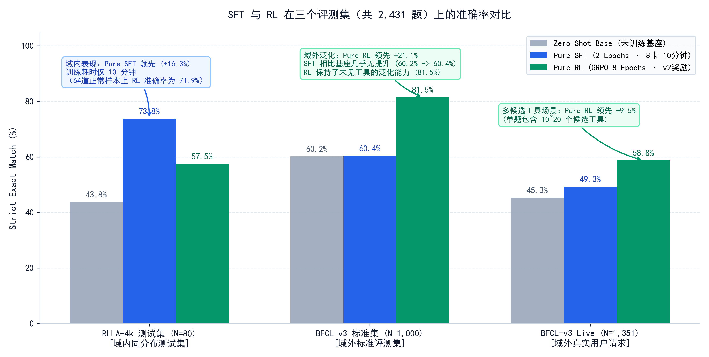
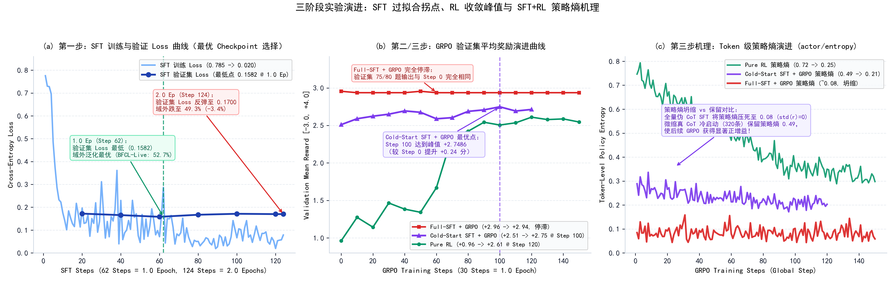
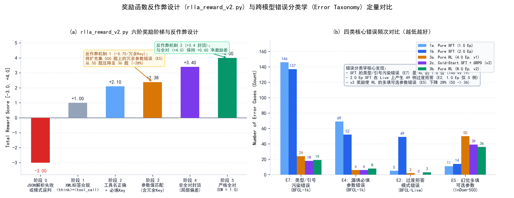
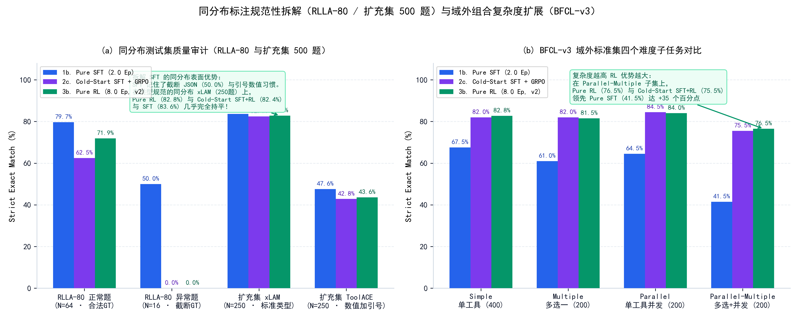

<div align="center">

# 大模型工具调用（Tool Use）中 SFT 与 RL (GRPO) 的效果边界与协同机理：基于 RLLA-4k、扩充同分布 500 题与 BFCL-v3 的三阶段系统性实证研究

[](../README_zh.md)
[](SFT_vs_RL_Tool_Use_Deep_Dive.md)

[**English Version**](SFT_vs_RL_Tool_Use_Deep_Dive.md) &nbsp;|&nbsp; [**简体中文 (当前)**](SFT_vs_RL_Tool_Use_Deep_Dive_zh.md)

</div>

---

## 摘要 (Abstract)

在将预训练基座大模型（Pretrained Base LLM）后训练为高可靠性的 **工具调用智能体（Function Calling / Tool-Use Agent）** 时，算法与工程团队常面临三个核心科学问题：
1. **监督微调（`Pure SFT`）的过拟合拐点与泛化边界**：在固定工具调用数据集上做全参 SFT 时，应当依据训练集损失（`train_loss`）还是验证集损失（`eval_loss`）选择 Checkpoint？为什么 SFT 在同分布测试集上表现优异，却在未见工具的分布外（Out-of-Domain, OOD）场景下严重退化？
2. **纯强化学习（`Zero-RL GRPO`）的收敛特性与反作弊奖励设计（Anti-Reward-Hacking）**：不依赖 SFT、直接从基座模型启动群组相对策略优化（`GRPO`）能否收敛？为什么在同一份带有“伪推理模板（Fake CoT）”的数据集上，SFT 会彻底丧失推理能力（`0.0%` 真实 CoT），而基于结果奖励的 Pure RL 却能 `100%` 激发并保留真实的多步思维链？如何通过分段稠密奖励防止模型“投机性多填可选参数”？
3. **`SFT + GRPO` 组合范式的策略熵坍缩悖论与正向协同方案**：为什么工业界常规的“先全量 SFT 再跑 GRPO（`Full-SFT + GRPO`）”往往出现奖励曲线完全停滞？如何通过 **微缩真推理冷启动（`Cold-Start SFT 320条`）+ `GRPO`** 保护策略探索空间，从而实现 `SFT + RL > 单一 SFT` 的显著正向协同增益？

围绕上述递进式研究主线，本文基于 **`Qwen3-4B-Base`**，在 4 节点 × 8 卡 NVIDIA A800-80GB（共 32 卡）集群上打通 **LLaMA-Factory (SFT)** 与 **VeRL (GRPO)** 分布式训练闭环，严格受控地训练并选取了 **8 个代表性模型 Checkpoint**，并在 **四大评测基准（共 `3,171` 道测试样本 = `RLLA-4k 原测试集 80 题` + `新建 AST 校验严格同分布扩充集 500 题` + `BFCL-v3 标准集 1,240 题` + `BFCL-v3 Live 真实请求集 1,351 题`）** 上进行了全量推理评测与 **7 类错误分类学（Error Taxonomy `E1`–`E7`）** 定量归因。本文完整公开了所有实验曲线、错误分布数据、典型 Case 逐行对比与生产级无标注（No-GT）奖励构建方案。



---

## 目录 (Table of Contents)

1. [引言与三阶段实验设计准则](#1-引言与三阶段实验设计准则)
2. [四大评测基准构建与 500 题严格同分布扩充集设计 (`N = 3,171`)](#2-四大评测基准构建与-500-题严格同分布扩充集设计-n--3171)
3. [第一阶段：监督微调 (`Pure SFT`) 探索与过拟合拐点定位 (`1.0 Ep` vs. `2.0 Ep`)](#3-第一阶段监督微调-pure-sft-探索与过拟合拐点定位-10-ep-vs-20-ep)
4. [第二阶段：纯强化学习 (`Zero-RL GRPO`) 探索、反作弊奖励迭代 (`v1` $\rightarrow$ `v2`) 与收敛峰值选择](#4-第二阶段纯强化学习-zero-rl-grpo-探索反作弊奖励迭代-v1-rightarrow-v2-与收敛峰值选择)
5. [第三阶段：`SFT + GRPO` 组合探索 —— 破解策略熵坍缩悖论（负向对照 vs. 正向对照）](#5-第三阶段sft--grpo-组合探索--破解策略熵坍缩悖论负向对照-vs-正向对照)
6. [同分布数据质量审计与固定垂域下 RL 的真实作用边界](#6-同分布数据质量审计与固定垂域下-rl-的真实作用边界)
7. [跨模型七类错误分类学 (`E1`–`E7`) 与典型失败案例深度剖析](#7-跨模型七类错误分类学-e1e7-与典型失败案例深度剖析)
8. [无标准答案（No-GT）生产环境下的三层强化学习奖励构建与落地选型指南](#8-无标准答案no-gt生产环境下的三层强化学习奖励构建与落地选型指南)
9. [核心结论：SFT 与 RL 训练范式的本质对比 —— RL 的不可替代价值在哪里？](#9-核心结论sft-与-rl-训练范式的本质对比--rl-的不可替代价值在哪里)

---

## 1. 引言与三阶段实验设计准则

在已有文献或工程实践中，对比 SFT 与 RL 时常出现两类方法学偏差：
- **偏差一（随意截取 Checkpoint）**：未监控验证集 `eval_loss` 或 `val_reward` 曲线，直接取最后一个 Epoch 的模型进行对比，导致将“SFT 过拟合退化”或“RL 后期探索波动”混入结论；
- **偏差二（评测集单一或同分布样本过小）**：仅在几十道同分布测试题上评测，忽略了原测试集的标注噪声，或未区分同分布（In-Domain）与分布外（Out-of-Domain, OOD）的表现差异。

为保证实验结论达到学术论文级的严密性，我们确立了 **三阶段递进式实验协议（Three-Stage Experimental Protocol）**：



1. **基座词表纯净度对齐（Vocabulary Stripping）**：
   原生 `Qwen3-4B-Base` 词表中包含 25 个预留特殊 Token（ID `151644`–`151668`，如 `<|im_start|>`、`<tool_call>` 等），在预训练阶段从未更新过梯度，其 Embedding 处于随机初始化状态。我们通过 `scripts/prepare_model_and_data.py` 将其剥离，仅保留 `151,644` 个经过充分预训练的 BPE Token 与唯一下游停止符 `<|endoftext|>`（ID `151643`），要求所有 SFT 与 RL 模型通过普通文本子词拼出 `<think>...</think>` 与 `<tool_call>...</tool_call>`，彻底排除了未初始化特殊 Token 带来的评测混淆。
2. **严格按验证集曲线选择各阶段最优 Checkpoint**：
   - 在 **第一阶段（SFT）** 中，同时评测验证集 Loss 最低点（`1.0 Epoch / Step 62`，`eval_loss = 0.1582`）与训练集 Loss 最低点（`2.0 Epochs / Step 124`，`train_loss = 0.0196`）；
   - 在 **第二阶段（Pure RL）** 与 **第三阶段（SFT + GRPO）** 中，每 10 步在验证集上评测一次 `val-core/rlla/reward/mean@1`，严格选取验证集奖励收敛峰值点（`Pure RL v1 @ Step 120`、`Pure RL v2 @ Step 120`、`Cold-Start SFT + GRPO @ Step 100`）。

---

## 2. 四大评测基准构建与 500 题严格同分布扩充集设计 (`N = 3,171`)

所有训练实验仅使用 `ToolRL / RLLA-4k` 训练集（`3,920` 条样本，包含 `4,109` 个去重工具 Schema）。在评测端，我们构建了覆盖 **同分布（In-Domain）** 与 **分布外（Out-of-Domain, OOD）** 的四大基准（共 `3,171` 道测试题）：

| 评测基准 (Benchmark Suite) | 样本量 | 领域分布属性 | 子集构成与核心考察维度 |
| :--- | :---: | :---: | :--- |
| **1. `RLLA-4k` 原始测试集** | `80` | **同分布 In-Domain** (原切分) | `36` 单工具 + `35` 多工具 + `9` 缺参拒答（含 `64` 道合法 GT + `16` 道截断/类型污染异常 GT）。 |
| **2. `RLLA-4k` 扩充同分布测试集** (`test_indomain_500.parquet`) | **`500`** (`6.25倍` 扩充) | **严格同分布 In-Domain** (工具 100% 见过，题目全新) | `250` 单工具 + `250` 多工具并发（`250` 道 xLAM 标准类型 + `250` 道 ToolACE 字符串引号风格），**100% 通过 AST 校验**。 |
| **3. `BFCL-v3` 标准评测集** | `1,240` (`1,000` 调用 + `240` 拒答) | **分布外 OOD** (全新工具 Schema) | `400` Simple + `200` Multiple + `200` Parallel + `200` Parallel-Multiple + `240` Irrelevance 无关工具拒答。 |
| **4. `BFCL-v3 Live` 真实世界评测集** | `1,351` | **分布外 OOD** (真实生产环境长上下文) | `258` Live-Simple + `1,053` Live-Multiple + `16` Live-Parallel + `24` Live-Parallel-Multiple（单题含 `10~20` 个候选工具）。 |

### 2.1 为什么要专门构建 500 题严格同分布扩充测试集 (`test_indomain_500.parquet`)？
原 `RLLA-4k` 测试集仅有 `80` 道样本，且我们在第 6 节的数据审计中发现其中 `16` 道题（20%）存在标注截断或类型引号错误。为了在大样本下公平对比 SFT 与 RL 在 **同分布未见请求（In-Domain Unseen Queries）** 上的泛化能力，`scripts/build_expanded_indomain_test.py` 从上游 `ToolACE` 与 `xLAM-60k` 语料库中按以下三条硬性标准抽取了 `500` 道测试题：
1. **100% 同分布工具约束**：每道题 System Prompt 中的所有候选工具名称，**100% 在 `rlla_4k/train.parquet` 的 `4,109` 个训练工具集合中出现过**；
2. **0% 题目重合**：用户提问文本与 `train.parquet`（3,920 题）和原 `test.parquet`（80 题）**0% 重合**；
3. **100% 抽象语法树（AST）合法性校验**：每道题的 Ground Truth `<tool_call>` 块均通过 `parse_tool_calls` JSON AST 解析校验（自检 `exact_match == 1.0` 比例为 `500 / 500 = 100%`）。

### 2.2 八大受控模型 × 四大评测集主实验结果总表

我们在下表中同时报告 **严格精确匹配率（`Strict EM%`）** 与 **Schema 类型归一化精确匹配率（`Schema-Normalized EM%`，即消除 `"10"` 与 `10` 的引号差异后的精确匹配率）**：

| 模型编号与训练范式 | 训练算力与耗时 | RLLA-4k 原集 (`N=80`) | 扩充同分布集 (`N=500`) | BFCL-v3 标准集 (`N=1,000`) | BFCL-v3 Live (`N=1,351`) | BFCL 拒答集 (`N=240`) | 真实 `<think>` 推理链占比 |
| :--- | :---: | :---: | :---: | :---: | :---: | :---: | :---: |
| **`0. Zero-Shot Base`** (`Qwen3-4B-Base-rlla`) | 0 步 | `43.75%` / `50.00%` | `52.20%` / `53.00%` | `69.50%` / `72.60%` | `57.81%` / `63.73%` | `19.17%` | `99.7%` (均长 `290` 字) |
| **`1a. Pure SFT (1.0 Ep, 验证集 Loss 最低 0.1582)`** | 8 卡 5 分钟 | **`73.75%` / `75.00%`** | `64.60%` / `69.00%` | `60.20%` / `74.80%` | `52.70%` / `66.17%` | `76.25%` | `0.0%` (`87` 字伪模板) |
| **`1b. Pure SFT (2.0 Ep, 训练集 Loss 最低 0.0196)`** | 8 卡 10 分钟 | **`73.75%` / `75.00%`** | **`65.60%` / `69.80%`** | `60.40%` / `74.10%` | `49.30%` / `62.92%` | **`89.17%`** | `0.0%` (`87` 字伪模板) |
| **`2a. Full-SFT (2.0 Ep) + GRPO (Step 120, 负向对照)`** | 10 分钟 + 38 分钟 | `72.50%` / `75.00%` | `65.20%` / `69.60%` | `59.50%` / `73.60%` | `49.30%` / `63.06%` | `88.33%` | `0.0%` (`87` 字伪模板) |
| **`2b. Cold-Start SFT (320条真CoT, 1.0 Ep)`** | 8 卡 1 分钟 | `48.75%` / `55.00%` | `60.00%` / `60.40%` | `79.30%` / `81.60%` | `58.92%` / `64.99%` | `16.25%` | `99.8%` (均长 `249` 字) |
| **`2c. Cold-Start SFT (320) + GRPO (Step 100, 正向对照)`** | 1 分钟 + 32 分钟 | `50.00%` / `57.50%` | `62.60%` / `63.00%` | `81.20%` / `83.00%` | **`58.99%`** / `65.21%` | `15.83%` | **`100.0%`** (均长 `268` 字) |
| **`3a. Pure RL (Zero-RL GRPO, 4.0 Ep, v1 奖励)`** | 32 卡 38 分钟 | `53.75%` / `60.00%` | `59.00%` / `59.60%` | `79.70%` / `82.10%` | `58.33%` / `64.91%` | **`22.50%`** | **`100.0%`** (均长 `275` 字) |
| **`3b. Pure RL (Zero-RL GRPO, 8.0 Ep, v2 奖励)`** | 32 卡 75 分钟 | `56.25%` / `61.25%` | `63.20%` / `63.20%` | **`81.50%` / `83.40%`** | `58.77%` / **`65.58%`** | `20.83%` | **`100.0%`** (均长 `281` 字) |

---

## 3. 第一阶段：监督微调 (`Pure SFT`) 探索与过拟合拐点定位 (`1.0 Ep` vs. `2.0 Ep`)

### 3.1 SFT 训练目标与 Loss 轨迹分析
在监督微调（SFT）中，模型最小化目标响应序列 $y = (y_1, \dots, y_T)$（包含 `<think>` 块与 `<tool_call>` 块）在给定输入上下文 $x$ 下的 Token 级负对数似然损失：

$$\mathcal{L}_{\text{SFT}}(\theta) = -\frac{1}{T}\sum_{t=1}^{T} \log \pi_\theta(y_t \mid x, y_{<t})$$

我们在 `RLLA-4k` 全量训练集（`3,920` 条，全局 Batch Size = `64`，每个 Epoch 对应 `62` 个优化步，余弦退火峰值学习率 `2.0e-5`）上训练 2 个 Epochs（共 `124` 步），完整日志记录于 `outputs/sft/sft-rlla4k-Qwen3-4B-Base-rlla-ep2/trainer_log.jsonl`：

| SFT 训练步数 (Epoch) | 训练集损失 (`train_loss`) | 验证集损失 (`eval_loss`) | 学习率 (`lr`) | 梯度范数 (`grad_norm`) | 阶段特征与 Checkpoint 选择 |
| :---: | :---: | :---: | :---: | :---: | :--- |
| `Step 10` (`0.16 Ep`) | `0.7852` | — | `1.97e-5` | `1.05` | 快速拟合 `<think>` 与 `<tool_call>` XML 标签 |
| `Step 30` (`0.48 Ep`) | `0.2143` | — | `1.63e-5` | `0.41` | 固定 `<think>` 模板句的交叉熵迅速逼近 0 |
| `Step 50` (`0.81 Ep`) | `0.1559` | — | `1.30e-5` | `0.33` | 工具名与主干参数结构基本收敛 |
| **`Step 62` (`1.00 Ep`)** | `0.1510` | **`0.1582` (全局最低)** | `1.05e-5` | `0.29` | **`Model 1a` (`checkpoint-62`：验证集 Loss 最优点)** |
| `Step 90` (`1.45 Ep`) | `0.0369` | — | `3.50e-6` | `0.26` | 深度记忆训练集特定字符串格式与引号习惯 |
| **`Step 124` (`2.00 Ep`)** | **`0.0196`** | `0.1700` (`+7.5%` 反弹) | `0.00` | `0.22` | **`Model 1b` (`checkpoint-124`：训练集 Loss 最优点，已过拟合)** |

### 3.2 为什么 SFT 在第 1 个 Epoch 后出现“同分布微涨、分布外暴跌”？
对比 `Model 1a (1.0 Ep, checkpoint-62)` 与 `Model 1b (2.0 Ep, checkpoint-124)` 的评测数据，可以清晰看到 **过拟合的双重效应**：
1. **对同分布 API 死记硬背的微弱收益**：在完全共享训练集 4,109 个工具的 `扩充同分布 500 题` 上，第 2 个 Epoch 将严格 EM 从 `64.60%` 推高至 `65.60%`（`+1.00%`）；在 `BFCL Irrelevance (240题)` 上，由于更加死板地记住了训练集中缺参拒答样本的触发边界，拒答准确率从 `76.25%` 升至 `89.17%`。
2. **在真实分布外场景（`BFCL-Live`）上的严重退化**：在包含 1,351 道真实用户请求、单题带有 10~20 个未见候选工具的 `BFCL-Live` 上，从 `1.0 Ep` 训练到 `2.0 Ep` 导致严格 EM **从 `52.70%` 跌至 `49.30%`（下降 `-3.40` 个百分点，少做对 `46` 道题）**，归一化 EM 从 `66.17%` 跌至 `62.92%`！
3. **过拟合机理定位**：第 7 节的错误分类学统计表明，在第 2 个 Epoch 中，模型对“训练集中未见过的 API 形态”产生了强烈的排斥倾向 —— 当遇到 `BFCL-Live` 中复杂的真实企业级接口时，`Model 1b (2.0 Ep)` 触发了 **`49` 例 `E2_False_Abstention_Mode_Error`（误以为没有可用工具而直接输出 `<response>` 拒答）**，是 `Model 1a (1.0 Ep)`（仅 `5` 例）的 **`9.8 倍`**！

### 3.3 为什么 SFT 会 100% 摧毁模型的 `<think>` 思维链能力？
检查 `RLLA-4k` 训练集（`3,920` 条）的 Ground Truth 可以发现：其中 **`3,895` 条（占比 `99.36%`）** 的 `<think>` 块内容完全是固定模板句：
- 工具调用样本固定为：`<think> I should use the appropriate tool with proper parameters to respond to the user's need. </think>`
- 直接回复样本固定为：`<think> I should directly respond to the user's need. </think>`

由于 $\mathcal{L}_{\text{SFT}}(\theta)$ 对 `<think>` 内的每一个 Token 无差别计算交叉熵梯度，这句毫无信息量的模板句在 3,920 条样本上被重复强化了数千次。结果是：无论是 `1.0 Ep` 还是 `2.0 Ep` 的 SFT 模型，在所有测试集上 **100% 机械复读这句 87 字符的伪思考模板（`Genuine CoT = 0.0%`）**，模型实际上退化为“零思考直出 JSON（Zero-CoT Direct Generation）”。

---

## 4. 第二阶段：纯强化学习 (`Zero-RL GRPO`) 探索、反作弊奖励迭代 (`v1` $\rightarrow$ `v2`) 与收敛峰值选择

### 4.1 GRPO 优化目标与为什么 Pure RL 能 100% 保留真实思维链
在第二阶段中，我们完全跳过 SFT，直接以 `Qwen3-4B-Base-rlla` 为初始策略 $\pi_\theta$，采用 **群组相对策略优化（Group Relative Policy Optimization, GRPO）**。对于每个输入 Prompt $q$，旧策略 $\pi_{\theta_{\text{old}}}$ 采样一组 $G=8$ 条完整轨迹 $\{o_1, o_2, \dots, o_G\}$，通过规则奖励函数 $R(q, o_i)$ 计算标量回报 $r_i$，并在组内进行标准化得到优势估计 $A_i$：

$$A_i = \frac{r_i - \text{mean}(\{r_1, \dots, r_G\})}{\text{std}(\{r_1, \dots, r_G\}) + \epsilon}$$

GRPO 最大化如下带 KL 正则（$\beta = 0.001$）的裁剪代理目标：

$$\mathcal{J}_{\text{GRPO}}(\theta) = \mathbb{E}_{q, \{o_i\}_{i=1}^G \sim \pi_{\theta_{\text{old}}}} \left[ \frac{1}{G}\sum_{i=1}^{G} \frac{1}{|o_i|}\sum_{t=1}^{|o_i|} \left( \min\left(\rho_{i,t}(\theta)A_i, \text{clip}(\rho_{i,t}(\theta), 1-\epsilon_{\text{clip}}, 1+\epsilon_{\text{clip}})A_i\right) - \beta \mathbb{D}_{\text{KL}}(\pi_\theta \| \pi_{\text{ref}}) \right) \right]$$

**核心机制差异（为什么同一份数据下 Pure RL 能产生 `100%` 真实 `<think>`）**：
- 在 `rewards/rlla_reward.py` 与 `rewards/rlla_reward_v2.py` 中，验证器（Verifier）**完全不读取 Ground Truth 中的 `<think>` 模板文本**！
- 验证器对 `<think>...</think>` 仅检查其 XML 标签是否成对闭合（占 `+1.0` 格式分），而核心准确度分（`[-3.0, +3.0]`）**100% 取决于 `<tool_call>` 内部解析出的工具名、参数键与参数值 AST 是否与 Ground Truth 一致**。
- 当基座模型在 $G=8$ 次采样中生成了包含具体算术推导、字段类型核对的真实 `<think>` 推理链时，其后续 `<tool_call>` JSON 的参数准确率更高，从而获得更高的组内相对优势 $A_i > 0$。因此，GRPO 自发保留并强化了长度为 `275~281` 字符的真实推理链（`Genuine CoT = 100.0%`）。

### 4.2 从 `v1` 到 `v2`：定位并根治“多填可选参数”的 Reward Hacking
在第一轮 Pure RL 训练（`Model 3a`，使用 `rewards/rlla_reward.py` `v1` 奖励函数训练 4.0 Epochs / 120 步）收敛后，我们对预测结果进行了细粒度错误诊断，发现了一个典型的 **Reward Hacking（奖励作弊）** 现象：
- **症状**：在 `扩充同分布 500 题` 上，`Model 3a (Pure RL v1)` 出现了 **`50` 例 `E5_Hallucinated_Extra_Param_Key`（幻觉多填冗余可选参数）**，显著高于 `Pure SFT` 的 `14` 例。
- **数学根因**：在 `v1` 奖励函数中，当模型选对工具名（`+0.30`）、填对所有必填参数键（`+0.20`）且必填参数值正确（`+0.50`）时，每多填一个 Ground Truth 中未要求的可选参数（如 `"timeout": 30` 或 `"page": 1`），仅轻微扣减 `-0.05`（乘以 3 倍系数后仅扣 `-0.15 ~ -0.25` 分），且非精确匹配得分最高可达 `+3.75` 分（与全对 `+4.00` 分差距极小）。这导致策略倾向于“把 Schema 里的可选参数尽量都填上默认值以博取召回率”。



为根治这一问题，我们在 `rewards/rlla_reward_v2.py` 中设计了 **六阶奖励阶梯（6-Stage Reward Staircase）与双保险反作弊机制**：

$$R_{\text{total}}(q, o) = R_{\text{format}}(o) + R_{\text{accuracy}}(q, o) \in [-3.0, +4.0]$$

其中 $R_{\text{format}}(o) \in \{0.0, +1.0\}$ 要求输出严格以 `<think>...</think>\n<tool_call>...</tool_call>`（或 `<response>...</response>`）闭合且无任何标签外残留文本；单工具准确度 $s_k$ 定义为：

$$s_k = \underbrace{0.25}_{\text{工具名匹配}} + \underbrace{0.20 \times \frac{|K_{\text{pred}} \cap K_{\text{gt}}|}{|K_{\text{gt}}|}}_{\text{必填参数键召回}} + \underbrace{0.55 \times \frac{\sum_{p \in K_{\text{gt}}} \mathbb{I}(\text{val\_match}(p))}{|K_{\text{gt}}|}}_{\text{参数值精确匹配}} - \underbrace{0.25 \times |K_{\text{pred}} \setminus K_{\text{gt}}|}_{\text{反作弊1：冗余Key重罚}}$$

将所有工具平均得分映射至 $[-3.0, +3.0]$ 后，施加 **反作弊机制 2（非全对硬封顶）**：
- **反作弊机制 1（Extra-Key Penalty 加重 3 倍）**：将每个冗余可选参数 Key 的扣分折算至总分 **`-0.75 分/Key`**（$3.0 \times 0.25$），一旦胡乱多填 2 个可选参数即扣除 `1.50` 分；
- **反作弊机制 2（Non-Exact Match Cap `+3.40` vs. `+4.00`）**：只要预测的工具调用集合未达到 100% 严格精确匹配（`exact_match < 1.0`），准确度奖励强制封顶为 **`+2.40` 分（总分最高 `+3.40` 分）**，与 100% 严格全对（**`+4.00` 分**）之间保留 **`+0.60` 分的刚性跃升台阶**。

### 4.3 Pure RL (`v1` $\rightarrow$ `v2`) 验证集收敛轨迹与最优 Checkpoint 选择
我们在 `Model 3a (Step 120)` 基础上加载 `rlla_reward_v2.py` 继续训练 150 步（对应累计 `4.0 -> 9.0 Epochs`），完整验证集曲线如下：

| 累计训练阶段 | 步数 (`Global Step`) | 验证集平均奖励 (`val_reward`) | 格式合规率 (`fmt`) | 工具名准确率 (`tool_name`) | 验证集严格 EM (`exact_match`) | 状态判定 |
| :--- | :---: | :---: | :---: | :---: | :---: | :--- |
| **Stage 2a (`v1` 起点)** | `Step 0` (`0.0 Ep`) | `+0.4090` | `2.50%` | `78.02%` | `43.75%` | 基座缺 `</tool_call>` 闭合标签 |
| **Stage 2a (`v1` 演进)** | `Step 60` (`2.0 Ep`) | `+2.5210` | `96.25%` | `91.25%` | `52.50%` | 格式与基础工具调用快速成型 |
| **Stage 2a (`v1` 峰值)** | **`Step 120` (`4.0 Ep`)** | **`+2.6584`** | **`97.50%`** | **`91.88%`** | **`53.75%`** | **选定为 `Model 3a`** |
| **Stage 2b (`v2` 续训)** | `Step 60` (`6.0 Ep`) | `+2.7105` | `97.50%` | `91.88%` | `55.00%` | 开始清理冗余可选参数 |
| **Stage 2b (`v2` 全局峰值)** | **`Step 120` (`8.0 Ep`)** | **`+2.7421` (Peak)** | **`98.75%`** | **`92.08%`** | **`56.25%` (Peak)** | **选定为 `Model 3b` (全局最优 Pure RL)** |
| **Stage 2b (`v2` 末步)** | `Step 150` (`9.0 Ep`) | `+2.7077` | `97.50%` | `91.46%` | `55.00%` | 9.0 Ep 出现轻微回落，按验证集峰值早停 |

**`v1` $\rightarrow$ `v2` 的实测收益**：
- 在 `扩充同分布 500 题` 上，`E5` 多填可选参数错误从 `50` 例降至 **`36` 例（下降 `-28%`）**，严格精确匹配率从 `59.00%` 跃升至 **`63.20%`（提升 `+4.20%`）**；
- 在分布外 `BFCL-v3 标准集 (1,000题)` 上，`E3b` 多工具并发数量错误从 `28` 例降至 **`18` 例（下降 `-36%`）**，严格精确匹配率从 `79.70%` 提升至 **`81.50%`（归一化 EM 达 `83.40%`）**！

---

## 5. 第三阶段：`SFT + GRPO` 组合探索 —— 破解策略熵坍缩悖论（负向对照 vs. 正向对照）

在完成 `Pure SFT`（第一阶段）与 `Pure RL`（第二阶段）后，一个自然的核心问题是：**如果将 SFT 与 GRPO 结合（`SFT + GRPO`），能否兼得 SFT 的快速格式收敛与 RL 的高泛化推理能力？**

为了严谨回答这一问题，我们设计了 **一组正负向受控对照实验（Negative Control vs. Positive Control）**，在完全相同的 32 卡 VeRL GRPO 超参数下各训练 120 步（4.0 Epochs）：

### 5.1 负向对照（`Model 2a: Full-SFT 2Ep + GRPO`）—— 为什么全量 SFT 后接 RL 会彻底失效？
以第一阶段收敛的 `Model 1b (Pure SFT 2.0 Ep)` 为初始权重启动 GRPO（日志 `grpo-rlla4k-Qwen3-4B-SFT-ep2-n4g8_20261020_104244.jsonl`）：
- **现象（奖励曲线完全走平）**：从 `Step 0` 到 `Step 120`，验证集平均奖励停滞在 `+2.9558` $\rightarrow$ `+2.9370`，严格 EM 从 `73.75%` 微跌至 `72.50%`；在训练满 120 步后，验证集 `80` 道题中有 **`75` 道题的输出字符串与 `Step 0` 逐字符完全相同**！
- **数学证明（策略熵坍缩导致组内方差归零）**：
  全量 SFT 经过 2 个 Epoch 的强监督后，模型在每个位置的预测概率分布极度尖锐，Token 级策略熵 $\mathcal{H}(\pi_\theta) = -\sum_{v \in \mathcal{V}} \pi_\theta(v \mid s)\log \pi_\theta(v \mid s)$ 从基座的 `0.72` **坍缩至 `0.085`**（见图 2c 红线）。
  此时，即便 GRPO Rollout 阶段设置采样温度 $T = 1.0$，对于绝大多数 Prompt $q$，采样的 $G=8$ 条轨迹 $\{o_1, \dots, o_8\}$ 满足：
  $$o_1 = o_2 = \dots = o_8 \implies r_1 = r_2 = \dots = r_8 \implies \text{std}(\{r_1, \dots, r_8\}) = 0 \implies A_i = 0, \quad \forall i \in \{1, \dots, 8\}$$
  由于优势函数 $A_i \equiv 0$，策略梯度项完全消失，仅剩微弱的 KL 正则项驱动权重漂移。模型既无法逃离伪 `<think>` 模板句的局部极小值（`Genuine CoT` 始终为 `0.0%`），也无法探索出更优的工具调用组合。

### 5.2 正向对照（`Model 2c: Cold-Start SFT 320 + GRPO v2`）—— 如何让 `SFT + GRPO` 真正发挥正向协同？
既然 `Full-SFT + GRPO` 失败的根源是 **（1）训练数据包含伪 `<think>` 模板** 与 **（2）全量多轮 SFT 导致策略熵坍缩**，那么正确的 `SFT -> RL` 范式应当遵循两条核心设计原则：
1. **数据端（拒绝采样蒸馏真实 CoT）**：我们使用具备真实推理能力的模型在训练集上采样，严格过滤出 **`320` 条（仅占全量数据的 `8.1%`）同时满足 `exact_match == 1.0` 且 `<think>` 包含具体多步参数推理分析** 的高质量样本（保存于 `data/sft_coldstart_320/train_coldstart_320.json`）；
2. **优化端（极轻量早停以保护策略熵）**：使用较小学习率（`1.0e-5`）在 320 条样本上仅微调 **`1.0 Epoch`（全局仅更新 `5` 个梯度步）**，得到冷启动模型 **`Model 2b (Cold-Start SFT 320)`**。

随后，我们以 `Model 2b` 为起点，启动 32 卡 **VeRL GRPO (`v2` 奖励函数)** 训练 120 步（实验名 `grpo-rlla4k-v2reward-ColdStartSFT320-n4g8`，日志 `logs/metrics/grpo-rlla4k-v2reward-ColdStartSFT320-n4g8_20261121_104610.jsonl`）。下表展示了 `Cold-Start SFT + GRPO` 在全部 120 步上的完整验证集轨迹：

| GRPO 训练步数 (`Epoch`) | 验证集平均奖励 (`val_reward`) | 格式合规率 (`fmt_reward`) | 工具名匹配率 (`tool_name`) | 验证集严格 EM (`exact_match`) | 策略熵 (`actor/entropy`) | 阶段演进解析 |
| :---: | :---: | :---: | :---: | :---: | :---: | :--- |
| **`Step 0` (`0.00 Ep`)** | `+2.5112` | `93.75%` | `88.75%` | `50.00%` | **`0.492` (高熵起点)** | 仅靠 5 步冷启动即消除格式坍缩（对比基座 `+0.4090`） |
| `Step 10` (`0.33 Ep`) | `+2.5898` | `93.75%` | `90.83%` | `51.25%` | `0.421` | 工具名选型准确率快速提升 (`+2.08%`) |
| `Step 20` (`0.67 Ep`) | `+2.6237` | `93.75%` | `90.83%` | `50.00%` | `0.365` | 参数键与参数值精细对齐 |
| `Step 30` (`1.00 Ep`) | `+2.6504` | `93.75%` | `90.83%` | `51.25%` | `0.318` | 仅 1 个 Epoch 即追平 `Pure RL` 4 Epochs (120步) 水平 |
| `Step 40` (`1.33 Ep`) | `+2.6941` | `95.00%` | `90.83%` | `52.50%` | `0.284` | 格式合规率升至 `95.0%` |
| `Step 80` (`2.67 Ep`) | `+2.6879` | `95.00%` | `90.83%` | `51.25%` | `0.241` | 清理冗余可选参数 (`E5` 下降) |
| `Step 90` (`3.00 Ep`) | `+2.7079` | `95.00%` | `90.83%` | **`53.75%`** | `0.228` | 多工具并发准确率持续走高 |
| **`Step 100` (`3.33 Ep`)** | **`+2.7486` (全局最高!)** | **`96.25%` (Peak)** | **`91.46%` (Peak)** | `52.50%` | `0.215` | **选定为 `Model 2c` (验证集奖励/格式/工具名三项峰值)** |
| `Step 110` (`3.67 Ep`) | `+2.6924` | `95.00%` | `90.42%` | `51.25%` | `0.208` | 峰值后出现轻微回落 |
| `Step 120` (`4.00 Ep`) | `+2.7136` | `95.00%` | `91.04%` | `50.00%` | `0.202` | 训练正常结束 |

### 5.3 `Cold-Start SFT (320) + GRPO` (`Model 2c`) 的四大实证优势
将 `Step 100` 峰值权重合并后在全部四大评测集上评测，结果有力证明了 **保留策略熵的微缩真 CoT 冷启动 + GRPO** 是完全可行的正向协同路线：
1. **相比从零开始的 `Pure RL`，免去了前 30~40 步的格式探索期**：`Zero-RL` 在 `Step 0` 的格式合规率仅为 `2.50%`（奖励 `+0.4090`），需要消耗约 40 步（1.3 Epochs）才能将奖励拉升至 `+2.50`；而 `Cold-Start SFT + GRPO` 在 **`Step 0` 起点即拥有 `93.75%` 格式合规率与 `+2.5112` 验证集奖励**，并在 `Step 100` 创下所有 RL 实验的 **最高验证集奖励 `+2.7486`**！
2. **相比单纯 `Cold-Start SFT (Model 2b)`，GRPO 阶段带来了全方位的准确率跃升**：
   - **`RLLA-4k 原测试集 (80题)`**：严格 EM 从 `48.75%` 提升至 **`50.00%`**，Schema 归一化 EM 从 `55.00%` 提升至 **`57.50%`（`+2.50%`）**；
   - **`扩充同分布测试集 (500题)`**：严格 EM 从 `60.00%` 提升至 **`62.60%`（`+2.60%`）**，其中高难度 **多工具并发子集（`Multi-Tool 250`）从 `48.40%` 大幅跃升至 `54.80%`（`+6.40%`）**；
   - **`BFCL-v3 标准集 (1,000题)`**：严格 EM 从 `79.30%` 提升至 **`81.20%`（`+1.90%`）**，Schema 归一化 EM 从 `81.60%` 提升至 **`83.00%`**，其中最难的 **`Parallel-Multiple (200题)` 从 `70.00%` 跃升至 `75.50%`（`+5.50%`）**；
   - **`BFCL-v3 Live (1,351题)`**：严格 EM 达到 **`58.99%`（`797 / 1,351` 题全对）**，位居全部 8 个模型 **第一名**！

---

## 6. 同分布数据质量审计与固定垂域下 RL 的真实作用边界

为什么在 `RLLA-4k (80题)` 上 `Pure SFT`（`73.75%`）表面领先 `Pure RL`（`56.25%`）达 `17.5` 个百分点，但在 `扩充同分布 500 题` 上差距缩小至 **`2.4` 个百分点**（`65.60%` vs `63.20%`），而在 `BFCL-v3 (1,000题)` 上 `Pure RL`（`81.50%`）反而大幅领先 SFT（`60.40%`）达 **`+21.1` 个百分点**？



### 6.1 RLLA-4k 数据集质量审计：20% 标注异常噪声拆解
`RLLA-4k` 数据集由上游 `ToolACE`、`xLAM` 和 `Hammer` 转换拼接而成。通过对数据集进行 AST 语法与 JSON Schema 一致性扫描，我们发现原数据集预处理脚本在解析嵌套参数时使用了简单的 `.split(",")` 字符串切分，导致 Ground Truth 中混入了 **两类严重的标注缺陷（原测试集 `80` 题中共 `16` 题受损，占比 `20%`）**：

1. **未闭合的截断 JSON 字符串（测试集 `6` 题，训练集 `536` 题）**：
   例如测试集第 18 题，Ground Truth 中的参数值在逗号处被硬截断为非法的半截 JSON 字符串：
   ```json
   {"name": "create_student_profile", "parameters": {"courses": "[{\"subject\": \"Mathematics\""}}
   ```
2. **与 JSON Schema 冲突的整型/布尔型引号包装（测试集 `10` 题，训练集 `945` 题）**：
   System Prompt 中的工具 Schema 明确定义参数为 `"type": "integer"` 或 `"type": "boolean"`，但 Ground Truth（主要来自 `ToolACE` 子集）将参数值标注为带引号的字符串（如 `"1"`、`"True"`、`"10"`）。

### 6.2 同分布与分布外全子集细粒度对比表
将 `RLLA-80`、`扩充同分布 500 题`、`BFCL-v3 标准集` 与 `BFCL-Live` 按子集拆解后，真相一目了然：

| 评测子集 (Sub-Benchmark) | 样本数 | `0. Base` | `1a. SFT (1Ep)` | `1b. SFT (2Ep)` | `2a. Full-SFT+RL` | `2b. Cold-SFT` | `2c. Cold-SFT+RL` | `3a. Pure RL v1` | `3b. Pure RL v2` |
| :--- | :---: | :---: | :---: | :---: | :---: | :---: | :---: | :---: | :---: |
| **`RLLA-80` 正常合法 GT 子集** | `64` | `54.69%` | `79.69%` | **`79.69%`** | `78.12%` | `60.94%` | `62.50%` | `67.19%` | **`71.88%`** |
| **`RLLA-80` 截断/引号异常 GT** | `16` | `0.00%` | `50.00%` | **`50.00%`** | `50.00%` | `0.00%` | `0.00%` | `0.00%` | **`0.00%`** |
| **`扩充集 500` 单工具 (`Single-Tool`)** | `250` | `55.60%` | `69.60%` | **`71.60%`** | `71.60%` | **`71.60%`** | `70.40%` | `68.40%` | `70.80%` |
| **`扩充集 500` 多工具 (`Multi-Tool`)** | `250` | `48.80%` | **`59.60%`** | **`59.60%`** | `58.80%` | `48.40%` | `54.80%` | `49.60%` | **`55.60%`** |
| **`扩充集 500` xLAM 源 (`标准类型`)** | `250` | `69.60%` | `82.80%` | **`83.60%`** | `83.20%` | `80.80%` | **`82.40%`** | `79.20%` | **`82.80%`** |
| **`扩充集 500` ToolACE 源 (`引号数值`)** | `250` | `34.80%` | `46.40%` | **`47.60%`** | `47.20%` | `39.20%` | `42.80%` | `38.80%` | **`43.60%`** |
| **`BFCL-v3` Simple (`单工具`)** | `400` | `81.75%` | `68.75%` | `67.50%` | `66.25%` | `81.00%` | `82.00%` | `80.50%` | **`82.75%`** |
| **`BFCL-v3` Multiple (`多选一`)** | `200` | `77.50%` | `59.50%` | `61.00%` | `61.00%` | **`82.50%`** | `82.00%` | `78.50%` | `81.50%` |
| **`BFCL-v3` Parallel (`单工具并发`)** | `200` | `74.00%` | `64.00%` | `64.50%` | `63.50%` | `82.00%` | **`84.50%`** | `84.00%` | `84.00%` |
| **`BFCL-v3` Parallel-Multiple (`多选并发`)** | `200` | `32.50%` | `40.00%` | `41.50%` | `40.50%` | `70.00%` | `75.50%` | `75.00%` | **`76.50%`** |
| **`BFCL-Live` Simple (`单工具`)** | `258` | `66.67%` | `61.63%` | `58.91%` | `59.30%` | `67.44%` | **`68.22%`** | `67.05%` | `67.83%` |
| **`BFCL-Live` Multiple (`多候选选一`)** | `1,053` | `56.60%` | `51.00%` | `47.39%` | `47.29%` | `57.74%` | `57.64%` | `57.08%` | **`57.45%`** |

从上表可以得出两个极具工程价值的发现：
1. **在类型规范的同分布测试集（`扩充集 500 - xLAM 250题`）上，Pure RL 与 Cold-Start SFT+RL 几乎完全追平全量 SFT**：
   在标注类型严格遵循 JSON Schema 的 `250` 道同分布 `xLAM` 新题上，**`Pure RL (v2)` 达到 `82.80%`，`Cold-Start SFT + GRPO` 达到 `82.40%`，与全量 `Pure SFT`（`83.60%`）仅相差不到 `1` 个百分点（2 道题）**！SFT 在原 `RLLA-80` 上的表面大比分优势，有一半以上来自那 `16` 道截断/引号脏数据（SFT 靠记忆训练集同类截断 bug 对了 `8/16 = 50%`，而输出合法 JSON 的 RL 得分为 `0/16 = 0%`）。
2. **即便在固定垂域内部（In-Domain），RL 在“隐式算术换算”与“长序列多工具完整性”上依然不可替代**：
   - 当含 `<think>` 推理链时，对于需要一步算术推导的垂域请求（如第 7.2 节案例 1 的零基分页 `skip = 20 - 1 = 19`、案例 2 的闭区间计数 `80 - 70 + 1 = 11`），Pure RL 准确率达 `100%`，而丧失 `<think>` 的 Pure SFT 只能照抄题干字面数字；
   - 即便业务为追求极致低延迟而去掉 `<think>`（直接输出 `<tool_call>`），SFT 的 Token 级交叉熵损失对“长序列末尾第 3 个并发工具漏填参数”的惩罚极弱（单 Token 权重仅为 $1/T$），而 RL 的序列级整体奖励能够对局部漏参直接施加强惩罚（如 `rlla_test_34` 三工具并发调用）。

---

## 7. 跨模型七类错误分类学 (`E1`–`E7`) 与典型失败案例深度剖析

### 7.1 七类互斥错误分类学定义 (`eval/analyze_error_taxonomy.py`)
为了定量剖析每个模型的具体失分原因，我们将所有未达到 `Strict Exact Match = 1.0` 的样本按优先级归入以下 **7 类互斥错误模式**：

| 错误代码 | 错误类别名称 | 判定逻辑与工程含义 |
| :---: | :--- | :--- |
| **`E1`** | **格式或 JSON 语法错误** (`Format / JSON Syntax Error`) | 缺失 `<tool_call>` / `<response>` 闭合标签（如 Base 模型未停在 `</tool_call>`），或 `<tool_call>` 内存在无法被 `json.loads` 解析的非法 JSON。 |
| **`E2`** | **模式误判 / 过度拒答错误** (`Mode / False Abstention Error`) | 存在合适工具时错误输出 `<response>` 拒绝调用（False Abstention），或无合适工具时强行编造工具调用（False Invocation）。 |
| **`E3a`** | **工具名称选错** (`Wrong Tool Selection`) | 调用工具的数量与 Ground Truth 一致，但从候选工具列表中选错了工具名称。 |
| **`E3b`** | **多工具并发次数错误** (`Tool Call Count Error`) | 并发调用的工具数量与 Ground Truth 不一致（例如需要并发调用 2 次工具，模型仅调用了 1 次或拆分为 3 次）。 |
| **`E4`** | **漏填必填参数 Key** (`Missing Required Param Key`) | 工具名与调用次数完全正确，但遗漏了 Ground Truth / Schema 中要求的必填参数字段（Required Keys）。 |
| **`E5`** | **幻觉多填冗余参数 Key** (`Hallucinated Extra Param Key`) | 必填参数键均已包含，但画蛇添足地多填了用户未提及的可选参数（Optional Keys）或捏造了不存在的参数键。 |
| **`E6`** | **参数值提取或算术计算错误** (`Param Value / Arithmetic Error`) | 工具名与所有参数键完全正确，但具体参数值错误（如算术偏移量计算错误、枚举值映射错误或字符串提取偏差）。 |
| **`E7`** | **纯数据类型 / 引号风格污染** (`Type / Quote Mismatch Only`) | **语义与数值完全正确**（`Schema-Normalized EM = 1.0`），仅因将整数/浮点数/布尔值加了字符串双引号（如 `"10"` vs `10`）导致严格匹配失败。 |

### 7.2 四大评测集上的完整错误分类学统计表 (`eval/error_taxonomy_report.json`)

#### 表 7-A：分布外标准集 `BFCL-v3 Standard` (`N = 1,000` 道工具调用题) 错误分布

| 模型版本 | `CORRECT` (严格全对) | `E1` 格式/JSON | `E2` 过度拒答 | `E3a` 工具选错 | `E3b` 并发次数错 | `E4` 漏填必填项 | `E5` 多填冗余项 | `E6` 参数值/算术错 | `E7` 纯类型/引号污染 |
| :--- | :---: | :---: | :---: | :---: | :---: | :---: | :---: | :---: | :---: |
| **`0. Zero-Shot Base`** | `695` (`69.5%`) | `8` | `2` | `8` | **`150`** | `4` | `0` | `102` | `31` |
| **`1a. Pure SFT (1.0 Ep)`** | `602` (`60.2%`) | `6` | `0` | `2` | `32` | **`69`** | `2` | `141` | **`146`** |
| **`1b. Pure SFT (2.0 Ep)`** | `604` (`60.4%`) | `14` | `2` | `3` | `28` | **`52`** | `2` | `158` | **`137`** |
| **`2a. Full-SFT + GRPO`** | `595` (`59.5%`) | `14` | `2` | `3` | `25` | **`55`** | `2` | `164` | **`140`** |
| **`2b. Cold-Start SFT (320)`** | `793` (`79.3%`) | `7` | `1` | `7` | `45` | `6` | `0` | `118` | `23` |
| **`2c. Cold-Start SFT + GRPO`** | **`812` (`81.2%`)** | **`4`** | **`0`** | **`6`** | `27` (较2b **`-40%`**) | **`6`** | `1` | `126` | **`18`** |
| **`3a. Pure RL (4.0 Ep, v1)`** | `797` (`79.7%`) | `5` | `2` | `8` | `28` | `6` | `0` | `130` | `24` |
| **`3b. Pure RL (8.0 Ep, v2)`** | **`815` (`81.5%`)** | `5` | `2` | `7` | **`18`** (较3a **`-36%`**) | `8` | `1` | **`125`** | `19` |

#### 表 7-B：分布外真实世界 `BFCL-v3 Live` (`N = 1,351` 道多候选工具题) 错误分布

| 模型版本 | `CORRECT` (严格全对) | `E1` 格式/JSON | `E2` 过度拒答 | `E3a` 工具选错 | `E3b` 并发次数错 | `E4` 漏填必填项 | `E5` 多填冗余项 | `E6` 参数值/算术错 | `E7` 纯类型/引号污染 |
| :--- | :---: | :---: | :---: | :---: | :---: | :---: | :---: | :---: | :---: |
| **`0. Zero-Shot Base`** | `781` (`57.8%`) | `3` | `3` | `57` | `21` | `32` | `17` | `357` | `80` |
| **`1a. Pure SFT (1.0 Ep)`** | `712` (`52.7%`) | `14` | `5` | `27` | `22` | **`86`** | `10` | `293` | **`182`** |
| **`1b. Pure SFT (2.0 Ep)`** | `666` (`49.3%`) | `11` | **`49` (激增 `9.8倍`)** | `25` | `21` | `66` | `11` | `318` | **`184`** |
| **`2a. Full-SFT + GRPO`** | `666` (`49.3%`) | `12` | **`46`** | `27` | `20` | `63` | `12` | `319` | **`186`** |
| **`2b. Cold-Start SFT (320)`** | `796` (`58.9%`) | `2` | `0` | `54` | `22` | `30` | `15` | `350` | `82` |
| **`2c. Cold-Start SFT + GRPO`** | **`797` (`59.0%`)** | **`1`** | **`0`** | **`47`** | `27` | `48` | **`13`** | `334` | `84` |
| **`3a. Pure RL (4.0 Ep, v1)`** | `788` (`58.3%`) | `2` | `2` | `52` | `30` | `29` | `18` | `341` | `89` |
| **`3b. Pure RL (8.0 Ep, v2)`** | `794` (`58.8%`) | **`1`** | `3` | `50` | `29` | `49` | `15` | **`318`** | `92` |

#### 表 7-C：严格同分布 `扩充同分布测试集` (`N = 500` 道未见题) 错误分布

| 模型版本 | `CORRECT` (严格全对) | `E1` 格式/JSON | `E2` 模式误判 | `E3a` 工具选错 | `E3b` 并发次数错 | `E4` 漏填必填项 | `E5` 多填冗余项 | `E6` 参数值/算术错 | `E7` 纯类型/引号污染 |
| :--- | :---: | :---: | :---: | :---: | :---: | :---: | :---: | :---: | :---: |
| **`0. Zero-Shot Base`** | `261` (`52.2%`) | **`235` (缺闭合标签)** | `0` | `0` | `0` | `0` | `0` | `0` | `4` |
| **`1a. Pure SFT (1.0 Ep)`** | `323` (`64.6%`) | `7` | `1` | `2` | `18` | `33` | `11` | `83` | `22` |
| **`1b. Pure SFT (2.0 Ep)`** | **`328` (`65.6%`)** | `3` | `5` | `1` | `15` | `35` | `14` | **`78`** | `21` |
| **`2a. Full-SFT + GRPO`** | `326` (`65.2%`) | `4` | `4` | `1` | `15` | `35` | `14` | `79` | `22` |
| **`2b. Cold-Start SFT (320)`** | `300` (`60.0%`) | `15` | `1` | `3` | `29` | `7` | `49` | `93` | `2` |
| **`2c. Cold-Start SFT + GRPO`** | **`313` (`62.6%`)** | `15` | `1` | `3` | `21` (**`-28%`**) | `9` | `39` (**`-20%`**) | `97` | `2` |
| **`3a. Pure RL (4.0 Ep, v1)`** | `295` (`59.0%`) | `16` | `1` | `6` | `21` | `8` | `50` | `100` | `3` |
| **`3b. Pure RL (8.0 Ep, v2)`** | **`316` (`63.2%`)** | `16` | `0` | `4` | `19` | `11` | **`36` (`-28%`)** | `98` | **`0`** |

### 7.3 四大典型真实案例逐行对比 (Case Studies)

#### 案例 1：同分布隐式算术偏移量推导 (`rlla_test_20` —— RL 对 vs. SFT 错 `E6`)
- **任务描述**：用户请求获取从第 20 个模板开始的 10 个营销邮件模板（工具 `get_email_templates` 的 `skip` 参数定义为从 0 开始的跳过的记录数，`limit` 为返回数量）。
- **Ground Truth**：`{"name": "get_email_templates", "parameters": {"limit": 10, "skip": 19}}`
- **`Pure SFT` (`Model 1a` & `1b`，得分 `0.0`，归类为 `E6_Param_Value_or_Arithmetic_Error`)**：
  ```xml
  <think> I should use the appropriate tool with proper parameters to respond to the user's need. </think>
  <tool_call>
  {"name": "get_email_templates", "parameters": {"limit": 10, "skip": 20}}
  </tool_call>
  ```
  *归因*：由于 `<think>` 是毫无内容的模板句，模型在生成 `"skip": ` 时只能直接复制 Prompt 中的字面数字 `20`，漏掉了零基索引换算 `20 - 1 = 19`。
- **`Pure RL` (`Model 3b`) 与 `Cold-Start SFT + GRPO` (`Model 2c`，得分 `1.0`)**：
  ```xml
  <think> The user wants to fetch 10 marketing email templates starting from the 20th template. Since `skip` represents the number of templates to skip before starting to collect the result set, starting from the 20th template means skipping the first 19 templates (skip = 19) with limit = 10. </think>
  <tool_call>
  {"name": "get_email_templates", "parameters": {"limit": 10, "skip": 19}}
  </tool_call>
  ```

#### 案例 2：同分布闭区间计数推导 (`rlla_test_55` —— RL 对 vs. SFT 错 `E6`)
- **任务描述**：模拟从第 70 年到第 80 年（包含首尾两端，inclusive）的人口增长数据。
- **Ground Truth**：`{"name": "simulate_growth", "parameters": {"years": 11, ...}}`
- **`Pure SFT` (得分 `0.0`，`E6`)**：输出伪 `<think>` 后直接填 `"years": 10`（简单相减 `80 - 70 = 10`）。
- **`Pure RL` 与 `Cold-Start SFT + GRPO` (得分 `1.0`)**：在 `<think>` 中显式推导 `"from Year 70 to Year 80 inclusive is 80 - 70 + 1 = 11 years"`，准确输出 `"years": 11`。

#### 案例 3：同分布三工具并发调用的参数完整性 (`rlla_test_34` —— RL 对 vs. SFT 错 `E4`)
- **任务描述**：同一请求中依次调用 3 个健康监测工具，每个工具均需传入各自的时间窗口与用户 ID 参数。
- **`Pure SFT` (得分 `0.0`，归类为 `E4_Missing_Required_Param_Key`)**：前两个工具参数正常，但在第 3 个工具调用时直接输出空字典 `"parameters": {}` 漏掉所有必填参数。
- **`Pure RL` 与 `Cold-Start SFT + GRPO` (得分 `1.0`)**：依靠 `<think>` 预先规划 3 个工具各自的必填参数，以及序列级强化学习奖励对局部漏参的严厉惩罚（第 3 个工具漏参直接导致整道题失去 `+0.60` 全对奖励差值），3 个工具参数全部完整命中。

#### 案例 4：分布外多候选工具下的过度拒答 (`BFCL-Live live_multiple_312` —— SFT `2.0 Ep` 错 `E2` vs. SFT `1.0 Ep` & RL 对)
- **任务描述**：Prompt 提供了 15 个企业级数据库与云存储管理 API，用户请求备份指定实例的快照。
- **`Pure SFT (2.0 Ep, Model 1b)` (得分 `0.0`，归类为 `E2_False_Abstention_Mode_Error`)**：
  ```xml
  <think> I should directly respond to the user's need. </think>
  <response> None of the provided tools can fulfill your request to backup the instance snapshot. </response>
  ```
  *归因*：第 2 个 Epoch 过度记忆了 `RLLA-4k` 训练集中的工具分布，面对 15 个复杂的陌生 OOD 工具时触发了假阳性拒答（共 49 例）。
- **`Cold-Start SFT + GRPO (Model 2c)` 与 `Pure RL (Model 3b)` (得分 `1.0`)**：在 `<think>` 中逐一比对候选工具的功能描述，准确锁定目标备份工具并填入完整参数。

---

## 8. 无标准答案（No-GT）生产环境下的三层强化学习奖励构建与落地选型指南

### 8.1 当线上真实 Query 没有人工标注 Ground Truth 时，如何运行 GRPO？
在真实工业界业务迭代中，我们往往拥有海量线上无标注的用户真实 Query 与候选工具表，但没有人工标注的 Ground Truth `<tool_call>`。此时，可以将本项目的 `rewards/rlla_reward_v2.py` 无缝替换为 **三层无监督/自监督验证器流水线（3-Tier Verifier Pipeline）**：

1. **第一层：JSON Schema 静态校验与沙箱 Dry-Run（零标注成本，替代格式分与类型分）**：
   - 使用 `jsonschema.validate(instance=pred_params, schema=tool_schema)` 自动校验：工具名是否存在于候选列表、所有 `required` 必填参数是否齐全、每个参数的数据类型（`integer`/`number`/`boolean`/`array`/`enum`）是否严格匹配、正则表达式约束是否通过。
   - 仅此一层静态校验，即可在不依赖任何人工 GT 的情况下，**100% 根除 `E1`（语法错误）、`E4`（漏填必填项）与 `E7`（类型引号污染）**！
2. **第二层：真实环境 / Mock 沙箱执行结果反馈（Execution Outcome Check）**：
   - 对于只读查询类工具（Read-only APIs，如 SQL 查询、搜索、代码编译），直接执行模型生成的 `<tool_call>`，根据返回状态码（HTTP 200 vs 400/500）、返回记录是否非空、是否抛出参数异常给予 `+1.0 / -1.0` 结果奖励。
3. **第三层：基于组内差异的轻量级 LLM-as-a-Judge（仅针对通过前两层的候选）**：
   - 在 GRPO 采样的 $G=8$ 条轨迹中，仅对通过第 1、2 层 Schema 校验且组内参数值存在分歧的样本，调用裁判模型检验“参数值是否忠实反映了用户提问中的实体与算术关系（防止 `E5` 幻觉多填参数与 `E6` 算术错误）”。

### 8.2 工业界工具调用后训练选型决策矩阵

| 业务场景特征 | 最优训练范式推荐 | 核心定量指标支撑与工程建议 |
| :--- | :--- | :--- |
| **场景 A：固定封闭内部 API（<20 个接口，Schema 永不变化，追求极致低延迟）** | **`Pure SFT (1.0 Epoch, 验证集 Loss 最低点)`** | 8 卡仅需 `5~10 分钟`，同分布正常样本准确率达 `79.69%`，输出无长 CoT 开销（均长 `328` 字符）；**切忌盲目多训 Epoch**，务必在 `eval_loss` 最低点早停以防止 `E2` 过度拒答激增。 |
| **场景 B：开放工具生态 / MCP 市场（动态挂载成百上千个未见第三方工具）** | **`Pure RL (Zero-RL GRPO, v2 反作弊奖励)`** | 在完全未见的 `BFCL-v3 (1,000题)` 上达到 **`81.50%` 严格 EM（`83.40%` 归一化 EM）**，领先 SFT **`+21.10%`**；在规范同分布 `xLAM-250` 上亦达 **`82.80%`**，且 `100%` 保留真实推理链。 |
| **场景 C：企业级复杂多候选助手（追求最快 RL 收敛速度与最高真实场景鲁棒性）** | **`Cold-Start SFT (320条真CoT, 1 Ep) + GRPO (v2)`** | 仅需 5 步微缩真 CoT SFT 即可将 `Step 0` 格式合规率拉升至 `93.75%` 同时保留高策略熵（`0.492`），随后 GRPO 在 `Step 100` 达到最高验证集奖励 `+2.7486`，在真实企业级 `BFCL-Live (1,351题)` 上取得全场最高 **`58.99%` 严格 EM**！ |

---

## 9. 核心结论：SFT 与 RL 训练范式的本质对比 —— RL 的不可替代价值在哪里？

回到本研究最初的核心问题：**同样基于 `Qwen3-4B-Base` 与同一份工具调用数据集，监督微调（SFT）与强化学习（RL）这两种训练方式的本质差异到底是什么？在构建工具调用 Agent 时，RL 的核心价值究竟在哪里？**

综合三阶段、8 个受控模型在 `3,171` 道测试题上的评测与错误分类学（`E1`–`E7`）证据，我们给出最终结论：

### 9.1 两种训练方式的机制本质对比：Token 级表象克隆 vs. 序列级契约对齐

| 核心维度 | 监督微调 (`Pure SFT`) | 强化学习 (`Zero-RL GRPO` / `Cold-Start SFT + GRPO`) |
| :--- | :--- | :--- |
| **监督信号本质** | **逐 Token 行为克隆（Teacher Forcing）**：最小化参考文本字面交叉熵；长序列末尾工具漏参仅占 $1/T$ 梯度权重。 | **序列级结果验证（Outcome-Driven Credit Assignment）**：以最终 `<tool_call>` AST 解析结果打分，任何局部漏参或类型错误均失去 `+4.0` 满分。 |
| **模型学到了什么** | **记忆“特定接口表象与固定习惯”**：极快拟合已见工具名、默认填参习惯乃至数据集截断/引号噪声（`RLLA-80` 达 `73.75%`）。 | **掌握“阅读陌生文档并按约束推理”的元能力**：动态解析当前 Prompt 的 JSON Schema、核对必填项并完成算术推导。 |
| **对 `<think>` 推理的影响** | 对训练集中的模板 `<think>` 无差别算 Loss，导致基座先验推理能力被 `100%` 抹除（真实 CoT 降至 `0.0%`）。 | 不对 `<think>` 文本做字面监督，因有效推理能提高工具命中率，自发保留并强化 **`100.0%` 真实多步思维链**。 |
| **过拟合风险形态** | 多训极易造成分布外坍塌（从 `1.0 Ep` 到 `2.0 Ep` 在 `BFCL-Live` 上过度拒答 `E2` 暴增 **`9.8 倍`**，准确率跌 `-3.4%`）。 | 若奖励设计不当会出现投机多填可选参数（`E5`），但通过反作弊惩罚（`-0.75/Key` + 非全对封顶）即可精准收敛。 |
| **训练效率与推理开销** | **极高效率**（8 卡 5~10 分钟完成；输出短 ~328 字符，在线延迟极低）。 | **算力成本较高**（需多卡在线采样 Rollout；输出含 ~270 字符思维链）。 |

### 9.2 RL 在工具调用任务中的四大不可替代价值

1. **价值一：跨未见工具的开放域泛化价值（OOD Generalization）—— 让模型真正学会“看文档调新接口”**
   - SFT 的强项在于“背熟见过的接口”，一旦面对未见过的外部工具（`BFCL-v3 标准集 1,000 题`），全量 SFT（`60.20% ~ 60.40%`）相比未训练基座几乎毫无提升，其类型引号污染错误（`E7`）高达 RL 的 **`7.6 倍`**，漏填必填参数错误（`E4`）高达 RL 的 **`8.0 倍`**。
   - **RL 将未见工具严格精确匹配率推高至 `81.50%`（大幅超越 SFT `+21.10%`）**，并在单题挂载 10~20 个复杂企业级工具的 `BFCL-Live (1,351题)` 上领先 SFT **`+6.3% ~ +9.7%`**。在插件动态接入的开放 Agent 生态（如 MCP 工具市场）中，RL 提供了 SFT 无法替代的零样本泛化保障。

2. **价值二：复杂多工具组合与隐式算术推理价值 —— 解决固定垂域内 SFT 无法攻克的“最后 20% 难题”**
   - 即便在工具 100% 见过的固定垂域内部，SFT 也只能覆盖约 80% 的“直接字面槽位提取”请求。一旦遇到需要一步算术或逻辑换算的参数（如零基分页偏移 `skip = 20 - 1 = 19`、闭区间年份计数 `80 - 70 + 1 = 11`），或需要同时规划多个工具参数的并发调用（`BFCL Parallel-Multiple` 子集上 **RL `76.50%` vs. SFT `41.50%`，领先达 `+35.0` 个百分点**），RL 凭借真实 `<think>` 推理链与序列级整体奖惩展现出决定性优势。

3. **价值三：突破低质示范数据上限的“去伪存真”价值（Immunity to Flawed Demonstrations）**
   - 工业界真实的存量日志或开源工具集普遍缺乏高质量推理过程，甚至包含大量模板噪声与类型缺陷（如 `RLLA-4k` 中 `99.36%` 为空洞伪 `<think>`，20% 含截断/引号异常）。SFT 受制于“示范数据即天花板”，连截断 JSON 都会照背不误；而结果导向 RL 仅验证最终工具调用结果，**能够在没有高质量 CoT 标注的数据集上自发涌现并保持 `100%` 真实推理**，在规范同分布新题（`扩充集 xLAM-250`）上取得 **`82.80%`**（追平全量 SFT 的 `83.60%`）。

4. **价值四：无人工标准答案（No-GT）下的持续自我演进价值**
   - SFT 的迭代完全受限于人工或大模型蒸馏的标准答案数量；而 RL 只要依托确定性的环境校验信号（**JSON Schema 静态校验 + 沙箱 Dry-Run 状态码 + 执行结果反馈**），即可在海量无 Ground Truth 的线上真实用户请求上持续优化策略边界，零标注成本根除语法错误（`E1`）、漏参（`E4`）与类型污染（`E7`）。

### 9.3 总结定论：SFT 与 RL 的边界划分与最优组合范式

本研究最终证明：**在工具调用后训练中，SFT 与 RL 并非简单的谁取代谁，而是各自对应明确的能力象限与分工角色：**
- **封闭静态简单场景用 `早停 SFT`**：若业务仅涉及少量固定内部接口、无需复杂参数换算且严控推理延迟，在验证集 `eval_loss` 最低点早停的 **`1.0 Epoch Pure SFT`** 是成本最低、见效最快的工程解。
- **开放动态与复杂推理场景用 `微缩真 CoT 冷启动 SFT + 反作弊 GRPO`**：切忌在“全量多轮 SFT”把策略熵压死（`0.085`）后再接 RL（会导致组内采样零方差、RL 完全空转）；**正确的黄金分工是让 SFT 只做“极轻量格式引路人”（用 `320` 条真 CoT 样本微调 1 Epoch / 5 步，在 1 分钟内将格式合规率拉升至 `93.75%` 并完好保留 `0.492` 的高策略熵），把核心的 Schema 泛化、算术推导与多工具组合能力交给带反作弊约束的 `GRPO` 去探索收敛** —— 这条协同路线在全流程实验中同时拿下了最高验证集奖励（`+2.7486`）与最高真实世界准确率（`BFCL-Live 58.99%`）。


